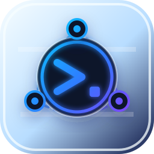
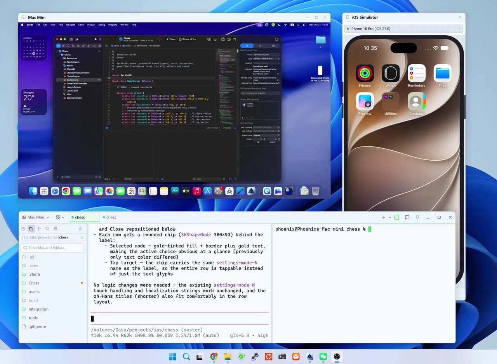

<div align="center">
  

  # Vibe Terminal

  **One desk. Every platform.**

  Run agents, terminals, desktops, and mobile simulators across your machines from one native workspace.

  [Website](https://vterminal.dev) · [Download](https://vterminal.dev/download) · [Documentation](https://vterminal.dev/docs/start/start-overview) · [FAQ](https://vterminal.dev/docs/faq) · [简体中文](./README.zh-CN.md)

  
</div>

## What is Vibe Terminal?

Vibe Terminal is a free, self-hosted terminal hub for cross-platform, server, and embedded development. A server runs on each machine you work on, while the desktop client and `vtermc` CLI give you one place to supervise agents and step in whenever a machine needs you.

It is built in Rust, collects no telemetry, and includes persistent sessions, visual Git, file editing, Markdown preview, remote screens, local voice input, and MCP tools.


## Get started

### 1. Install Vibe Terminal

Download the desktop client for **Windows**, **macOS**, or **Linux**, and install the server on each machine you want to manage. Desktop and headless Linux packages are available.

**[Open the download page](https://vterminal.dev/download)** to choose your platform and architecture.

On Linux, the installer detects WSL and graphical sessions, then selects the appropriate package:

```bash
curl -fsSL https://vterminal.dev/install.sh | bash
```

### 2. Configure the server

Open the server's Web UI, go to **Server**, and set a **Secret Key**. The Web UI configures the server; everyday terminal work happens in the desktop client or `vtermc`.

### 3. Connect a client

Pair the desktop client with the QR code or encrypted share string in the Web UI. You can also enter the server's `wss://host:port` address and secret key manually.

Once connected, open a terminal and start working. Sessions remain on the server when the client closes or the network drops.

**Next:** [Connecting a Client](https://vterminal.dev/docs/start/start-connect) · [Using the Web UI](https://vterminal.dev/docs/start/start-webui) · [Command-line Client](https://vterminal.dev/docs/terminal/terminal-cli)

## Everything around the terminal

| Capability | What you can do |
| --- | --- |
| **Every machine** | Watch and control Windows, macOS, and Linux desktops, iOS simulators, and Android devices from one app. |
| **Persistent sessions** | Close the client, lose the network, or switch machines without stopping terminals, agents, or streams. |
| **Terminal workspace** | Split panes, group tabs by machine, detach windows, and receive completion notifications. |
| **Files and visual Git** | Search and edit files, preview Markdown, stage changes, create worktrees, rebase, and resolve conflicts. |
| **Agent supervision** | Run coding agents in real terminals, inspect their native history, reply from a structured panel, and drive terminals through MCP. |
| **Screenshots and voice** | Annotate screenshots into terminal input and dictate with speech recognition that runs locally on your server. |
| **Remote access** | Connect directly, through DDNS, or through an outbound-WSS relay with encrypted control and media streams. |
| **Embedded and extensions** | Operate UART consoles with agents and extend the server with JavaScript addons. |

## Documentation

| Topic | Guides |
| --- | --- |
| **Getting started** | [Overview](https://vterminal.dev/docs/start/start-overview) · [Connect a client](https://vterminal.dev/docs/start/start-connect) · [Web UI](https://vterminal.dev/docs/start/start-webui) |
| **Terminals and agents** | [Using terminals](https://vterminal.dev/docs/terminal/terminal-usage) · [CLI](https://vterminal.dev/docs/terminal/terminal-cli) · [Agent history](https://vterminal.dev/docs/terminal/terminal-agent-history) · [MCP](https://vterminal.dev/docs/terminal/terminal-mcp) |
| **Files and Git** | [Files](https://vterminal.dev/docs/files/files-overview) · [Visual Git](https://vterminal.dev/docs/git/git-overview) |
| **Remote desktop** | [Overview](https://vterminal.dev/docs/remote-desktop/rd-overview) · [Server setup](https://vterminal.dev/docs/remote-desktop/rd-server) · [Client](https://vterminal.dev/docs/remote-desktop/rd-client) |
| **Connectivity and security** | [Relay](https://vterminal.dev/docs/relay/relay-overview) · [Certificates and TLS](https://vterminal.dev/docs/certificates/cert-overview) · [DDNS](https://vterminal.dev/docs/remote/remote-ddns) |
| **More features** | [Voice input](https://vterminal.dev/docs/voice/voice-server) · [UART serial](https://vterminal.dev/docs/terminal/terminal-uart) · [Addons](https://vterminal.dev/docs/addon/addon-overview) |
| **Help** | [FAQ](https://vterminal.dev/docs/faq) · [Downloads and system requirements](https://vterminal.dev/download) |

The documentation is available in multiple languages on [vterminal.dev](https://vterminal.dev/docs/start/start-overview).

## Source repositories

This repository holds the server (`crates/vterm-server`), the `vtermc` command-line client (`crates/vterm-cli`), the agent runtime (`crates/vterm-agent`), the Web UI (`webui/`), the Docker build environment and the Linux packaging scripts. The desktop client is distributed as a download from [vterminal.dev](https://vterminal.dev/download). The shared libraries live in their own repositories and are included as git submodules under `crates/`:

| Repository | Component |
| --- | --- |
| [vterm-common](https://github.com/aurga-vibeterminal/vterm-common) | Shared helpers: diagnostics, latency, private CA / TLS, system proxy detection |
| [vterm-core](https://github.com/aurga-vibeterminal/vterm-core) | Wire protocol, Noise-protocol crypto, PTY handling, folder streaming |
| [vterm-emulator](https://github.com/aurga-vibeterminal/vterm-emulator) | Terminal emulation: VT parsing, screen model, scrollback, selection |
| [vterm-transport](https://github.com/aurga-vibeterminal/vterm-transport) | Framed, size-limited, encrypted peer-to-peer message transport |

Clone with its submodules:

```bash
git clone --recurse-submodules https://github.com/aurga-vibeterminal/vibe-terminal
```

## Reporting bugs and requesting features

Use [GitHub Issues](https://github.com/aurga-vibeterminal/vibe-terminal/issues) to report bugs or suggest improvements.

Before opening an issue, search for an existing report and check the [FAQ](https://vterminal.dev/docs/faq). For bug reports, include:

- Vibe Terminal version, client OS, and server OS;
- what you expected and what actually happened;
- minimal reproduction steps and relevant logs.

**Do not post secret keys, pairing strings, access tokens, credentials, or private code.**

## Privacy

Vibe Terminal has **zero telemetry**. Sessions and credentials stay on your infrastructure, pairing keys are not shared in plain text, and local voice recognition keeps audio and text on your machine. Optional AI features use the providers you configure.

Read the [FAQ](https://vterminal.dev/docs/faq) for more about data storage and securely exposing services.

---

<div align="center">
  Built by <a href="https://vterminal.dev">AURGA</a> · Free · Self-hosted · Pure Rust
</div>
