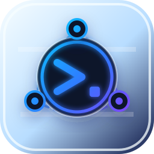
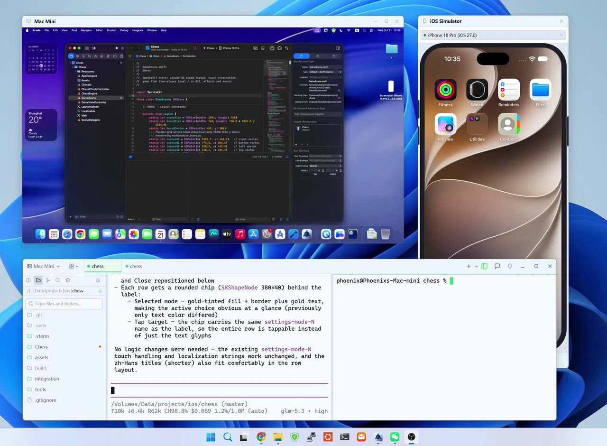

<div align="center">
  

  # Vibe Terminal

  **一个工作台，连接所有平台。**

  在一个原生工作区中，运行并管理不同机器上的 Agent、终端、远程桌面和移动模拟器。

  [官网](https://vterminal.dev/zh) · [下载](https://vterminal.dev/zh/download) · [使用文档](https://vterminal.dev/zh/docs/start/start-overview) · [常见问题](https://vterminal.dev/zh/docs/faq) · [English](./README.md)

  
</div>

## Vibe Terminal 是什么？

Vibe Terminal 是一个免费、自托管的终端中心，面向跨平台、服务器和嵌入式开发。在每台工作机器上运行一个服务端，即可通过桌面客户端或 `vtermc` 命令行客户端统一监督 Agent，并在机器需要你时立即接管。

它使用 Rust 构建，不收集遥测数据，并内置持久会话、可视化 Git、文件编辑、Markdown 预览、远程屏幕、本地语音输入和 MCP 工具。


## 快速开始

### 1. 安装 Vibe Terminal

下载适用于 **Windows**、**macOS** 或 **Linux** 的桌面客户端，并在每台需要管理的机器上安装服务端。Linux 同时提供桌面版和无界面（Headless）软件包。

**[打开下载页面](https://vterminal.dev/zh/download)**，选择你的平台和处理器架构。

在 Linux 上，安装脚本会检测 WSL 和图形会话，并自动选择合适的软件包：

```bash
curl -fsSL https://vterminal.dev/install.sh | bash
```

### 2. 配置服务端

打开服务端的 Web UI，进入 **Server**，设置 **Secret Key**。Web UI 用于配置服务端；日常终端操作在桌面客户端或 `vtermc` 中完成。

### 3. 连接客户端

使用 Web UI 中的二维码或加密分享字符串配对桌面客户端，也可以手动输入服务端的 `wss://host:port` 地址和 Secret Key。

连接后即可打开终端开始工作。即使关闭客户端或网络中断，会话仍会保留在服务端继续运行。

**下一步：**[连接客户端](https://vterminal.dev/zh/docs/start/start-connect) · [使用 Web UI](https://vterminal.dev/zh/docs/start/start-webui) · [命令行客户端](https://vterminal.dev/zh/docs/terminal/terminal-cli)

## 终端所需，尽在于此

| 能力 | 你可以做什么 |
| --- | --- |
| **连接每台机器** | 在一个应用中查看并控制 Windows、macOS 和 Linux 桌面、iOS 模拟器及 Android 设备。 |
| **持久会话** | 关闭客户端、网络中断或切换机器，都不会停止终端、Agent 或屏幕流。 |
| **终端工作区** | 拆分窗格、按机器分组标签页、拖出独立窗口，并接收任务完成通知。 |
| **文件与可视化 Git** | 搜索和编辑文件、预览 Markdown、暂存更改、创建 Worktree、变基并解决冲突。 |
| **Agent 监督** | 在真实终端中运行编码 Agent，查看原生对话历史，从结构化面板回复，并通过 MCP 操作终端。 |
| **截图与语音** | 将标注后的截图作为终端输入，并通过服务端本地语音识别进行听写。 |
| **远程访问** | 通过直连、DDNS 或基于出站 WSS 的中继连接，控制与媒体流均经过加密。 |
| **嵌入式与扩展** | 让 Agent 操作 UART 控制台，并通过 JavaScript Addon 扩展服务端。 |

## 使用文档

| 主题 | 指南 |
| --- | --- |
| **快速开始** | [概览](https://vterminal.dev/zh/docs/start/start-overview) · [连接客户端](https://vterminal.dev/zh/docs/start/start-connect) · [Web UI](https://vterminal.dev/zh/docs/start/start-webui) |
| **终端与 Agent** | [使用终端](https://vterminal.dev/zh/docs/terminal/terminal-usage) · [命令行客户端](https://vterminal.dev/zh/docs/terminal/terminal-cli) · [Agent 历史](https://vterminal.dev/zh/docs/terminal/terminal-agent-history) · [MCP](https://vterminal.dev/zh/docs/terminal/terminal-mcp) |
| **文件与 Git** | [文件](https://vterminal.dev/zh/docs/files/files-overview) · [可视化 Git](https://vterminal.dev/zh/docs/git/git-overview) |
| **远程桌面** | [概览](https://vterminal.dev/zh/docs/remote-desktop/rd-overview) · [服务端设置](https://vterminal.dev/zh/docs/remote-desktop/rd-server) · [客户端](https://vterminal.dev/zh/docs/remote-desktop/rd-client) |
| **连接与安全** | [中继](https://vterminal.dev/zh/docs/relay/relay-overview) · [证书与 TLS](https://vterminal.dev/zh/docs/certificates/cert-overview) · [DDNS](https://vterminal.dev/zh/docs/remote/remote-ddns) |
| **更多功能** | [语音输入](https://vterminal.dev/zh/docs/voice/voice-server) · [UART 串口](https://vterminal.dev/zh/docs/terminal/terminal-uart) · [Addon](https://vterminal.dev/zh/docs/addon/addon-overview) |
| **帮助** | [常见问题](https://vterminal.dev/zh/docs/faq) · [下载与系统要求](https://vterminal.dev/zh/download) |

官网[使用文档](https://vterminal.dev/docs/start/start-overview)提供多种语言版本。

## 源码仓库

本仓库包含服务端（`crates/vterm-server`）、`vtermc` 命令行客户端（`crates/vterm-cli`）、agent 运行时（`crates/vterm-agent`）、Web UI（`webui/`）、Docker 构建环境和 Linux 打包脚本。桌面客户端以下载形式分发，见 [vterminal.dev](https://vterminal.dev/download)。共享基础库各自独立成库，以 git submodule 的形式放在 `crates/` 下：

| 仓库 | 组件 |
| --- | --- |
| [vterm-common](https://github.com/aurga-vibeterminal/vterm-common) | 共享辅助：诊断、延迟测量、私有 CA / TLS、系统代理检测 |
| [vterm-core](https://github.com/aurga-vibeterminal/vterm-core) | 线协议、Noise 协议加密、PTY 处理、目录流 |
| [vterm-emulator](https://github.com/aurga-vibeterminal/vterm-emulator) | 终端模拟：VT 解析、屏幕模型、回滚历史、选区 |
| [vterm-transport](https://github.com/aurga-vibeterminal/vterm-transport) | 帧式、限长、加密的点对点消息传输 |

克隆时请带上 submodule：

```bash
git clone --recurse-submodules https://github.com/aurga-vibeterminal/vibe-terminal
```

## 反馈问题与功能建议

请通过 [GitHub Issues](https://github.com/aurga-vibeterminal/vibe-terminal/issues) 报告问题或提出改进建议。

提交前，请先搜索已有 Issue 并查看[常见问题](https://vterminal.dev/zh/docs/faq)。报告问题时，请提供：

- Vibe Terminal 版本、客户端操作系统和服务端操作系统；
- 预期行为与实际行为；
- 最小复现步骤及相关日志。

**请勿公开 Secret Key、配对字符串、访问令牌、凭据或私有代码。**

## 隐私

Vibe Terminal **不收集遥测数据**。会话与凭据保存在你自己的基础设施中，配对密钥不会以明文分享，本地语音识别会将音频和文本保留在你的机器上。可选 AI 功能使用你自行配置的服务提供商。

阅读[常见问题](https://vterminal.dev/zh/docs/faq)，进一步了解数据存储与服务安全暴露。

---

<div align="center">
  由 <a href="https://vterminal.dev/zh">AURGA</a> 构建 · 免费 · 自托管 · 纯 Rust
</div>
