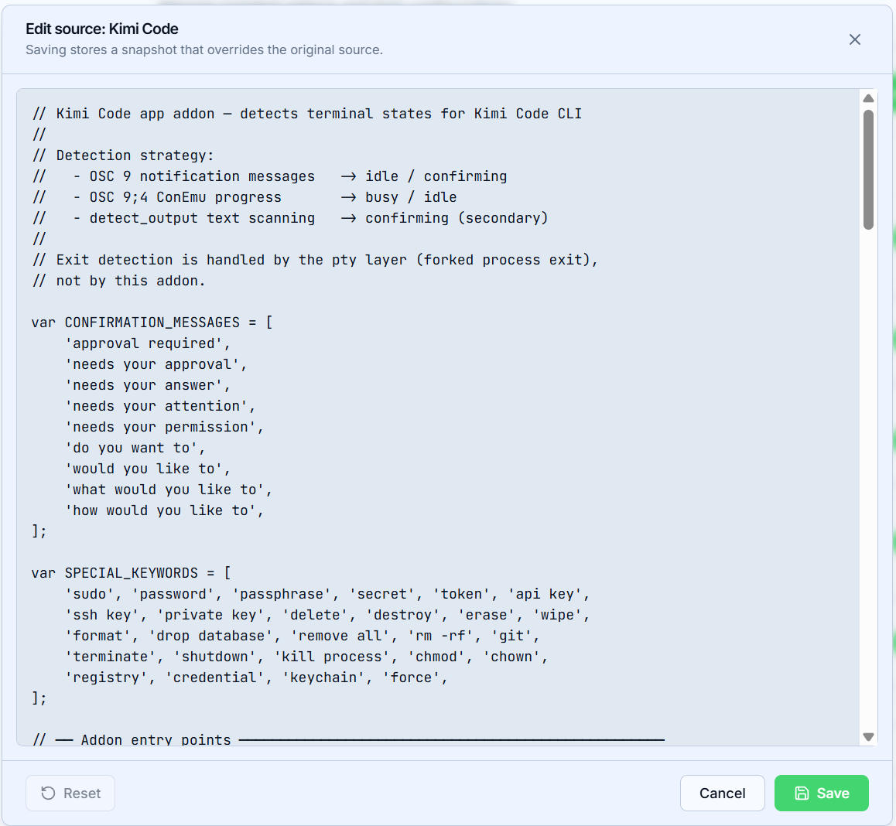

There are two levels of customization: patch the source of an existing addon, or write a new one modeled on a built-in and upload it.

## Hot-patching source

The pencil button on any addon card opens its JavaScript source for editing. Saving stores a snapshot that overrides the original — for built-in and uploaded addons alike — and the change takes effect immediately, without a restart. Use it to tweak a prompt, fix a URL, or prototype an idea on the live system.

`Reset` drops the snapshot and restores the pristine source (built-ins only — an uploaded addon is already yours).

## Writing your own addon

An addon is two files:

- `<id>.json` — the manifest: `id`, `name`, `description`, `author`, `email`, `date`, `type`, and `config_fields` (key, label, field type, default, description) that the Web UI turns into a form;
- `<id>.js` — the source: a plain JavaScript file (run by an embedded QuickJS engine, with an `addon.get_config()` bridge to the configured fields) exporting the functions its type calls — e.g. `chat_completion()` for an LLM provider, tool listings and bridge calls for an MCP addon.

The fastest start is to export an existing addon: the `Export` button on its card downloads a zip with the manifest and the source together. Pick the built-in closest to your goal (they also live in `crates/vterm-server/src/addon/builtins/`), adjust the id, name, type and the exported functions, then install the result with `Upload Addon`. Uploaded addons can be deleted again with the trash button.

## Storage

Uploaded addons and source snapshots live in the `addons/` folder of the config directory as `<id>.json` + `<id>.js`, so they survive restarts. For a built-in id only the `.js` override is honored — the built-in keeps its own manifest.
