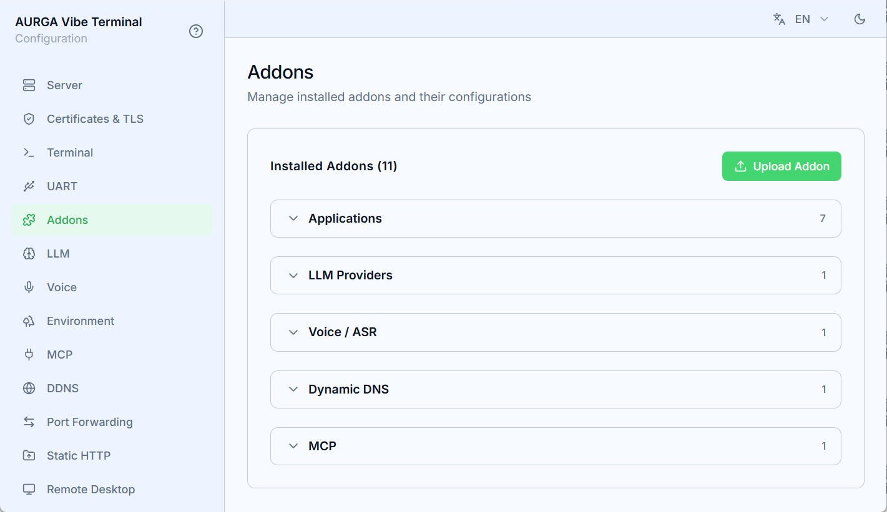

Addons extend the server with new capabilities without touching the core: LLM providers, voice-recognition backends, dynamic DNS updaters, extra MCP tool surfaces, and agent-app detection all live as addons. The `Addons` section of the Web UI manages them.

## Categories

Every addon declares a type, and the section groups the cards accordingly:

- **Applications** — teach the terminal observer about a Code Agent CLI (Claude Code, Codex, Kimi Code, Pi and OpenCode are built in): process detection, busy/idle status, automation hooks;
- **LLM Providers** — chat-completion backends that the AI features pick from (an OpenAI-compatible provider is built in);
- **Voice / ASR** — speech-recognition backends (the built-in `vibe-voice` addon points at the supervised local ASR server);
- **Dynamic DNS** — keep a hostname mapped to the current address (Cloudflare is built in);
- **MCP** — extra MCP tool surfaces served on the MCP host (EasyEDA Pro is built in);
- anything else lands in the **Other** group.

## Built-in and uploaded addons

- **Built-in** addons ship inside the program and are always available. Their manifest and source are pristine — an overridden source can be restored at any time;
- **Uploaded** addons are your own: a zip holding a manifest and a JavaScript source, installed through the `Upload Addon` button;
- The `Modified` badge marks an addon whose source you have overridden.

Each card shows the addon's type, its badges and an enable toggle; expanding it reveals the description, author, configuration fields and source code.

## Configuration

An addon's manifest declares its config fields, and the expanded card turns them into a form. Values are stored per addon and only take effect while the addon is enabled; password-type fields stay masked. Toggling an addon off keeps its configuration, so re-enabling picks up where you left off.
