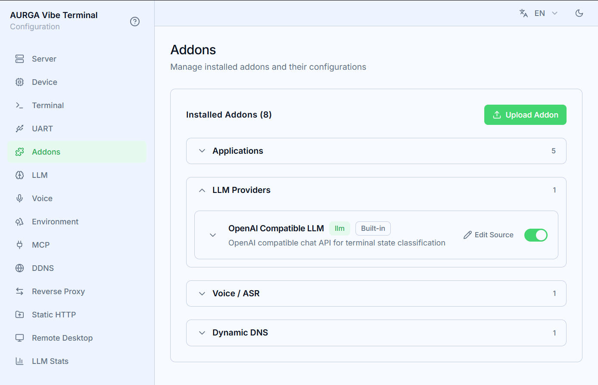
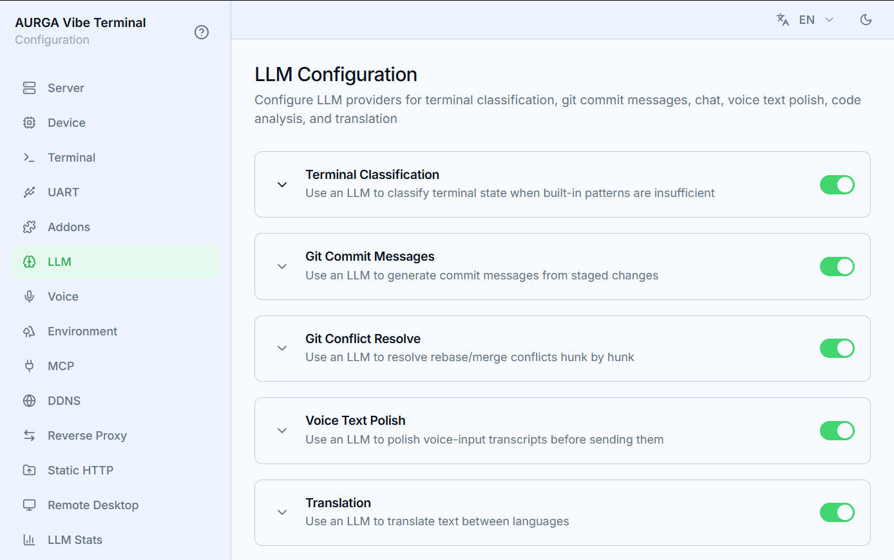
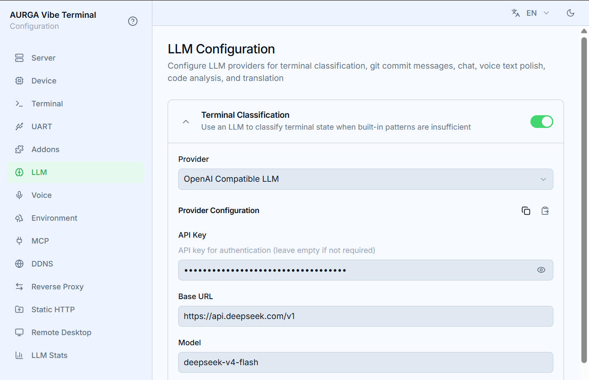

The `LLM` section of the Web UI assigns an LLM provider to each AI feature — terminal classification, Git commit messages, conflict resolution, voice text polish, and translation. Providers themselves are LLM-type addons managed in the `Addons` section.

## Providers are addons

LLM providers live in the `LLM` group of the `Addons` section:

- An **OpenAI Compatible LLM** provider is built in; custom providers can be uploaded as a zip (`Upload` button). The addon manifest declares the config fields (API key, base URL, model, …) that the Web UI turns into a form;
- A provider only appears in the feature pickers while its addon is **enabled** — toggle it on in the Addons section first;
- Use the pencil button on an addon card to edit its source; a built-in addon you have modified can be rolled back with `Reset`.

## Per-feature configuration

Each feature card in the `LLM` section has its own enable toggle and its own provider pick, so different jobs can use different models:

- **Terminal Classification** — classifies terminal state when built-in patterns are insufficient. `Max Consecutive Failures` disables the LLM for the session after that many failed calls (minimum 3);
- **Git Commit Messages** — generates commit messages from staged changes;
- **Git Conflict Resolve** — resolves rebase/merge conflicts hunk by hunk;
- **Voice Text Polish** — polishes voice-input transcripts before sending them;
- **Translation** — translates text into the selected target language.

Expand a card to pick its `Provider` and fill in the provider's fields. Configuration is saved even while the feature is disabled and only takes effect once enabled. When several features use the same provider addon, the copy/paste buttons next to `Provider Configuration` let you clone its field values between them (see below).

Terminal and Git features offer an output language with an `Auto` option (the model decides); translation uses an explicit English/简体中文 target list.

## Copy/paste between features

Every feature keeps its own copy of the provider's fields, so using one provider for several features normally means re-typing the same Base URL, API key, and model in each card. The `Provider Configuration` header has two small buttons that remove the repetition:

- **Copy** — copies the field values currently shown in this card, along with the provider addon they belong to;
- **Paste** — appears in a card only when the provider selected there is the same addon as the copied config; clicking it fills the card's fields with the copied values.

To share one endpoint between, say, Git commit messages and translation: pick the provider and fill in its fields in the first card, press **Copy**, open the other card (with the same provider selected) and press **Paste**. The pasted values are stored in that feature's own configuration like any other field edit and are saved with it. The clipboard is in-page only — it is cleared when you leave the LLM section.

## The OpenAI-compatible provider

The built-in provider works with any OpenAI-compatible chat API. Key fields:

- `Base URL` / `API Key` / `Model` — endpoint, credentials, model name;
- `Extra Body` — a JSON object merged into every request body, for model-specific parameters;
- `Max Input Tokens` / `Max Output Tokens` — prompt budgeting and completion cap;
- `Timeout` — per-request timeout in seconds; raise it for slow local models.

## Recommended models

These AI jobs are small, latency-sensitive prompts, so a fast "just right" model beats a large reasoning model:

- **Local: Qwen3.5 9B** — a sweet spot for Git commit message generation, terminal classification, translation, and voice polish. Serve it with an OpenAI-compatible endpoint (Ollama, vLLM, llama.cpp) and point `Base URL` at it;
- **API: DeepSeek V4 Flash (`deepseek-v4-flash`)** — fast enough for interactive use and capable of handling all of the features above.

> Thinking mode adds seconds of latency and rarely helps these short tasks — turn it off in `Extra Body` for a better experience, e.g. `{"enable_thinking": false}` for Qwen or `{"thinking": {"type": "disabled"}}` for DeepSeek (the exact key depends on your serving stack; the JSON is merged verbatim into the request body).
