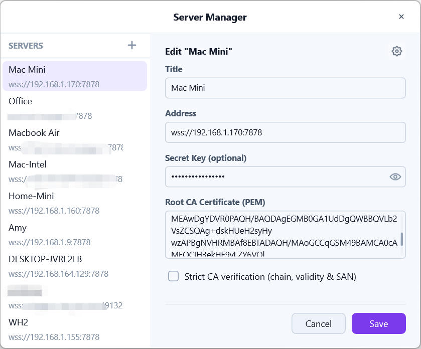

By default a client encrypts every connection but does not verify who is on the other end — the same trust-on-first-use posture as accepting a self-signed certificate in a browser. **Strict verification** changes that: the client checks the server's certificate against a Root CA you provide and refuses to connect unless the chain, validity, and SANs all check out. This makes man-in-the-middle attacks on the connection effectively impossible, at the cost of one manual step: giving the client the server's Root CA.

## Where to set it up

Strict verification is configured per server in the client's server edit panel, alongside the address and secret key:

1. `Root CA Certificate (PEM)` — a multiline field for the server's Root CA public certificate;
2. `Strict CA verification (chain, validity & SAN)` — only selectable once a CA has been entered.

## Getting the Root CA onto the client

Two ways, from the same source (the server's `Certificates & TLS` page — see the Domains & SAN Management page):

- **Copy & paste** — press `Copy Root CA` in the Web UI and paste the PEM into the client's `Root CA Certificate (PEM)` field;
- **Import a share string** — share strings produced by the client embed the Root CA alongside the address and key. Importing such a share prefills the CA field automatically, so the recipient only has to tick the strict checkbox.

The CA is the same for every client and never changes across certificate renewals — set it once per server.

## What strict mode checks

With the checkbox enabled, every connection to that server must present a certificate that:

1. Chains to the configured Root CA — a certificate signed by anything else is rejected;
2. Is within its validity window — expired or not-yet-valid certificates are rejected;
3. Carries a SAN matching the address you are connecting to — a certificate issued for different names is rejected.

If any check fails, the connection is refused with an error explaining which check failed. Without the checkbox (or without a CA), connections stay encrypted but skip these checks.

## Verify the fingerprint

Before trusting the CA, confirm you have the real one: the `Certificates & TLS` page shows the Root CA's SHA-256 fingerprint. Compare it against the PEM you are about to paste (or the PEM embedded in a share you received). If they differ, do not enable strict verification — get the CA through a trusted channel instead.

## Common failures

- `SAN mismatch` — you are connecting by a name or IP that is not in the certificate. Add it on the server (see the Domains & SAN Management page) and reissue;
- `Certificate expired or not yet valid` — the server's clock is wrong, or the leaf failed to renew. Check the certificate status in the Web UI;
- `Not signed by the configured CA` — the CA in the field belongs to a different server, or the connection is being intercepted. Compare fingerprints before proceeding.
