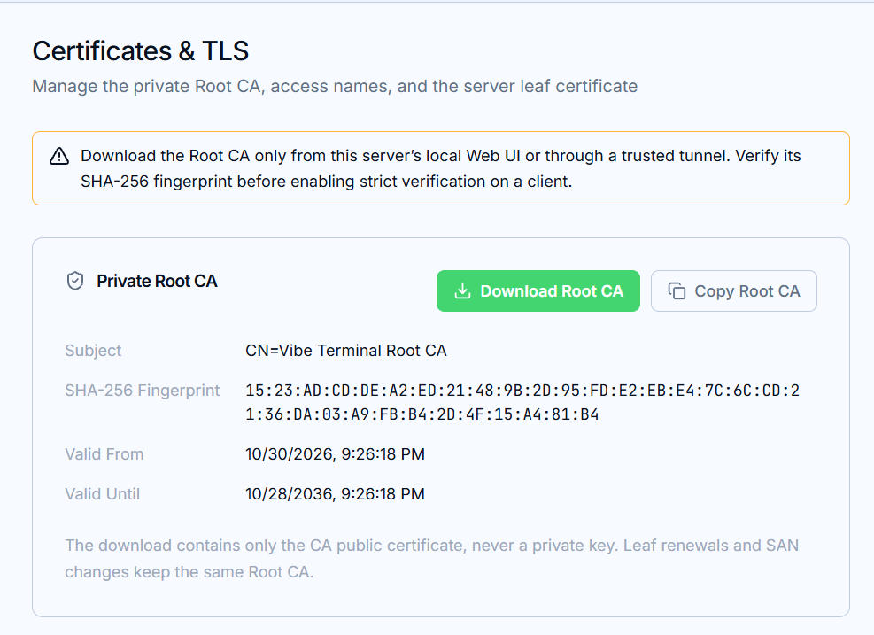

The server protects every TLS endpoint it exposes — the Web UI, client connections, and forwarded ports — with a certificate issued from its own **private Root CA**. This page in the Web UI (`Certificates & TLS` in the sidebar) is where you manage that CA, control which names the certificate is valid for, and hand the CA to clients that want to verify the server strictly.

## How it works

- The server generates a private Root CA once and keeps it for the lifetime of the installation. Everything is signed by it;
- The CA signs a **leaf certificate** for the server with a 90-day lifetime, covering the hostnames and IP addresses clients actually use to reach it;
- When the machine's hostnames, network interfaces, or SAN entries change, the leaf is reissued automatically — the Root CA never changes, so clients that already trust it keep trusting the server;
- A new leaf is swapped in through a shared certificate resolver and hot-reloaded: existing connections are never dropped, and new handshakes immediately pick up the latest certificate. If a renewal fails, the previous certificate stays active.

## What you'll find on the page

1. `Private Root CA` — download or copy the CA's public certificate to distribute to clients (and their browsers). The download never contains a private key;
2. `Domains & IP Addresses (SAN)` — the list of names the leaf certificate is valid for. Covered on the next page, Domains & SAN Management;
3. `Server Leaf Certificate` — the live certificate: status, subject, SHA-256 fingerprint, validity window, and SAN entries.

## Custom TLS certificates

If a custom TLS certificate is configured for the server, it stays in charge: the managed certificate on this page is still generated and kept up to date, but it does not replace the configured custom identity. The page shows a notice while a custom identity is active.

## Why trust the Root CA

Clients that only need encryption work out of the box. Clients that want to *verify* the server — the strict mode described on the last page, Strict Verification on Clients — need the Root CA's public certificate, and it must travel over a channel you trust:

> Download the Root CA only from this server's local Web UI or through a trusted tunnel, and verify its SHA-256 fingerprint (shown on this page) before enabling strict verification anywhere.

The same CA also signs the certificates used by port forwarding (see the Port Forwarding page). Once a device trusts the Root CA, forwarded URLs open without the browser's *connection is not private* warning.
