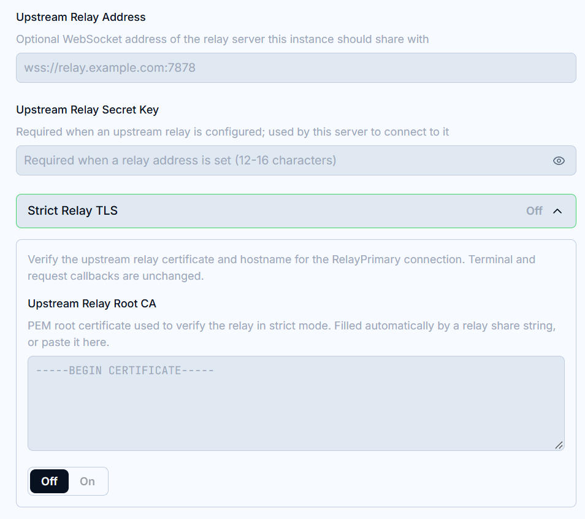

By default a shared server encrypts its upstream connection to the relay but does not verify who is on the other end — the same trust-on-first-use posture as accepting a self-signed certificate in a browser. **Strict Relay TLS** changes that: the shared server checks the relay's certificate against a Root CA you provide and refuses to connect unless the chain, validity, and hostname all check out. This makes man-in-the-middle attacks on the relay link effectively impossible, at the cost of one manual step: giving the shared server the relay's Root CA. It applies the same idea as the previous page, Strict Verification on Clients, to the shared server's upstream relay link.

## Where to set it up

Strict verification is configured on the shared server — the machine whose `Relay Address` points at the relay. In its Web UI, open the `Server` section: below the `Relay Secret Key` sits a `Strict Relay TLS` row showing the current `On` / `Off` state. Expand it to reveal:

1. `Upstream Relay Root CA` — a multiline field for the relay's Root CA public certificate (PEM);
2. An `Off` / `On` toggle — `On` is only selectable once the PEM parses as a valid certificate.

Changes to the relay settings are never saved mid-edit: review the values and press `Apply`. Saving reconnects the upstream relay with the new settings immediately.

## Getting the Root CA onto the shared server

Two ways, from the same source (the relay's own Web UI):

- **Paste a share string** — click the `QR code` on the relay server's Web UI. The share string embeds the relay's Root CA alongside the address and key, so pasting it into the shared server's `Relay Address` field auto-fills the CA field too (see the Setup Guide under Relay). Strict mode still stays off until you review the CA and switch it on yourself;
- **Copy & paste** — press `Copy Root CA` on the relay's `Certificates & TLS` page and paste the PEM into the `Upstream Relay Root CA` field.

The CA is the same for every shared server and never changes across certificate renewals — set it once per relay.

Before trusting the CA, confirm you have the real one: the relay's `Certificates & TLS` page shows the Root CA's SHA-256 fingerprint. Compare it against the PEM you are about to paste. If they differ, do not enable strict verification — get the CA through a trusted channel instead.

## What strict mode checks

With the toggle `On`, the upstream `RelayPrimary` connection must present a certificate that:

1. Chains to the configured Root CA — certificates signed by anything else, including public system roots, are rejected;
2. Is within its validity window — expired or not-yet-valid certificates are rejected;
3. Carries a SAN matching the host of the `Relay Address` you connect to — a certificate issued for different names is rejected.

One limit to keep in mind: only the upstream relay connection is verified. Terminal and request callbacks keep the existing certificate policy.

If any check fails, the connection is refused and retried in the background with increasing delays; the shared server stays unreachable through the relay until the check passes or you turn strict mode back off.

## Common failures

- `Strict TLS verification requires a Root CA PEM` — the toggle is on but the CA field is empty. Paste the PEM first;
- SAN mismatch — you are dialing the relay by a name or IP that is not in its certificate. Add the name on the relay's `Certificates & TLS` page (see the Domains & SAN Management page) and reissue;
- `Certificate expired or not yet valid` — the relay's clock is wrong, or its leaf certificate failed to renew. Check the certificate status on the relay;
- Not signed by the configured CA — the CA in the field belongs to a different relay, or the connection is being intercepted. Compare fingerprints before proceeding.
