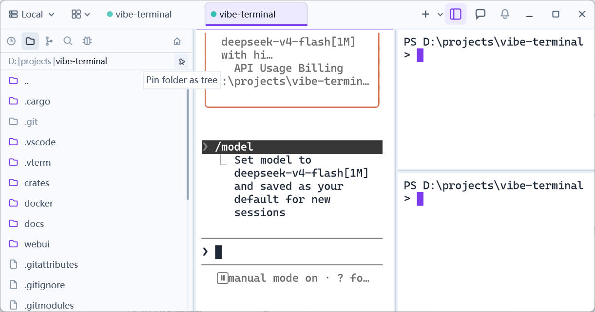
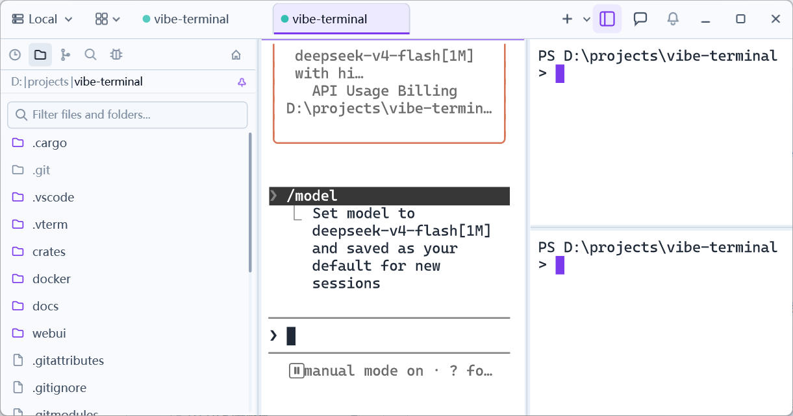

The file explorer operates the server-side file system. The toolbar at the top of the left panel switches between Recent / Explorer / Git / Debug / Search; Explorer is the file browser.

## The Home button: jump to the terminal's cwd

Click the `Home` (house) button in the toolbar:

- Switches to the `Explorer` view;
- Jumps to the **working directory of the active terminal** (its cwd);
- Pins that directory as a tree and clears the search box — you always start from "wherever the terminal is, that's what you see".

## Tree mode and search

- **Pin as tree**: the pin button at the right end of the breadcrumbs toggles between the flat list and tree mode. In tree mode folders expand into a collapsible directory tree (the Home jump pins automatically);
- **Search**: the search box at the top filters the current list by name as you type; `Search in Folder` from the Recent context menu runs a recursive search over a whole directory.

## Basic operations

Right-click a file or folder:

- **Create**: `New Folder` / `New File`;
- **Edit**: `Rename`; `Copy` / `Cut` / `Paste` (works across directories);
- **Delete**: `Delete`, with a confirmation dialog;
- **Terminal tie-in**: `Open in Terminal` opens a new terminal tab at that directory; `cd to Directory` cds the current terminal there;
- **OS tie-in**: `Reveal in File Explorer` shows a local directory in the system file manager;
- **Paths**: `Copy Full Path` / `Copy Relative Path`;
- **Serve**: `Host with HTTP server` publishes the directory as an HTTP file service (see Host with HTTP Server); `Open in App` opens it with an agent app detected on the server.

Every operation acts on the server-side file system; remote sessions behave exactly like local ones.
