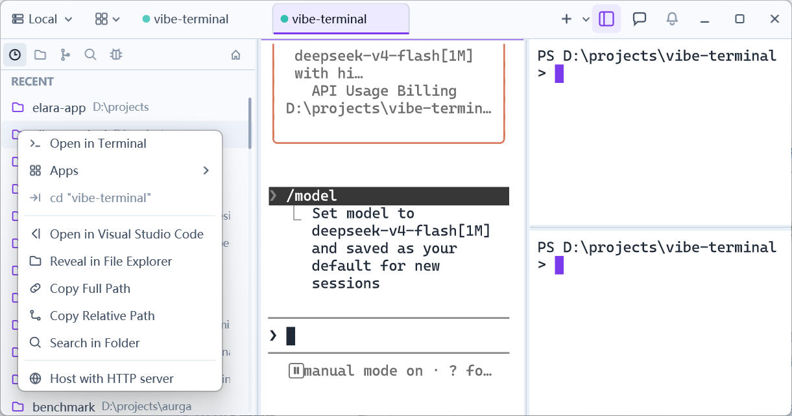

File management lets you work with files on the server directly from the client: the left activity bar has two entries — `Recent` (recent projects) and the file explorer — used alongside terminal tabs. Everything operates on the session's server: the local machine, or a remote/shared machine over a relay.

## Recent: recent projects

`Recent` lists the folders your code agents opened most recently on the current server, newest first:

- **Click** an entry and the file explorer switches to that directory;
- **Right-click** opens a menu of quick actions:
  - `Open in VS Code` — open the directory in VS Code on this machine;
  - `Reveal in File Explorer` — show it in the OS file manager;
  - `Copy Full Path` / `Copy Relative Path` — full path, or path relative to the repository;
  - `Search in Folder` — search files inside that directory;
  - `Open in Terminal` — open a new terminal tab there; `cd Here` — cd the current terminal to it;
  - `Host with HTTP server` — publish the directory as an HTTP file service (see Host with HTTP Server);
  - `Open in App` — open it with an agent app detected on the server.

## The file explorer

The `Explorer` tab browses and manages the server-side file system: directory navigation, tree and flat views, search, create/rename/delete and other file operations, plus drag-and-drop upload and download between the server and this machine. See File Explorer and Upload & Download.
