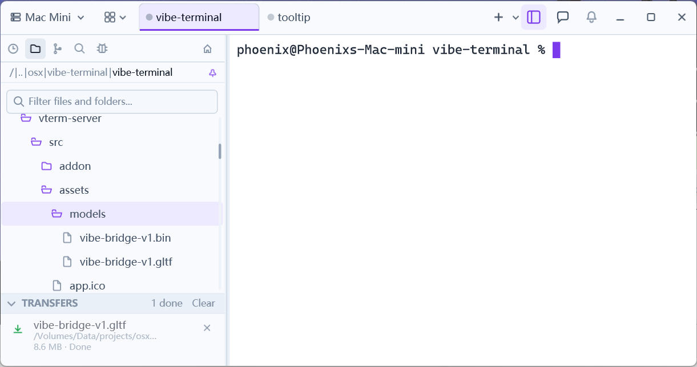

File transfers between your machine and the server are drag & drop, and the direction is the meaning: **drag in = upload to the server, drag out = download to this machine**. Transfers ride the encrypted client-server connection; remote and shared servers behave like local ones.

## Uploading: drag in

Drag files (or whole folders) from your OS file manager onto the file list and release:

- In tree mode, **dropping on a folder row** uploads into that folder; **dropping at the root** (the insertion line between rows) uploads into the current root directory;
- A transfer row appears at the bottom of the list showing `Uploading`, the file name, and a progress bar;
- Completion shows `Uploaded n file(s)`; failures include the reason (e.g. permission denied) and the list refreshes to reveal the new files.

## Downloading: drag out

Press a file in the list, drag it out of the client window, and drop it into your OS file manager (or the desktop):

- The file streams down from the server to where you dropped it;
- Transfer rows show progress the same way; **a finished download row is clickable** and opens the local download folder;
- Multi-select and drag several files at once.

> Drag & drop moves single files between this machine and one server; to move data between two servers, combine Host with HTTP Server or terminal commands (scp/rsync).
