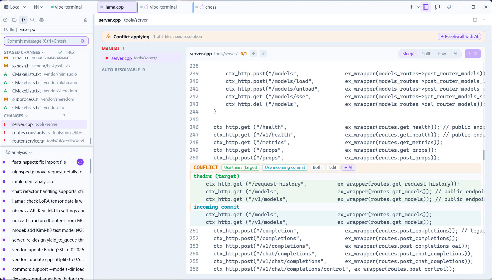

When a rebase or merge hits conflicts, the panel switches to the conflict view: the conflict file list on the left, the merge editor on the right. Conflicted files also show up in the `CHANGES` list with a `!` badge — clicking one jumps straight into this view instead of a plain diff. The editor offers four resolution modes and you can switch between them at any time.

## The conflict file list

Files are grouped by state: those auto-merged successfully (staged automatically) and those still needing manual attention. Click a file to open it in the editor; the list updates live as you resolve, until it's empty.

## The four resolution modes

- **Merge** (default) — conflicts are presented hunk by hunk; per hunk choose `take ours` / `take theirs` or edit the merged result inline;
- **Split** — a diff is broken into finer line-level segments, so both sides can be adopted piece by piece within one hunk;
- **Raw** — plain editing with `diff3` conflict markers (`<<<<<<<` / `=======` / `>>>>>>>`) for hand-tuning;
- **AI** — an agent resolves the file hunk by hunk: the LLM analyzes each conflicted hunk and produces solution cards with an explanation and confidence. You can type instructions to steer the strategy (e.g. "prefer theirs, keep the log statements"), pause, fine-tune in another mode, and resume — already-resolved hunks are skipped.

In every mode the resolution is written into the file in your session and staged, exactly like a manual edit.

## Continuing the rebase

Once every conflict is resolved, the rebase moves on to the next commit; you can also abort at any point to return to the pre-rebase state.
