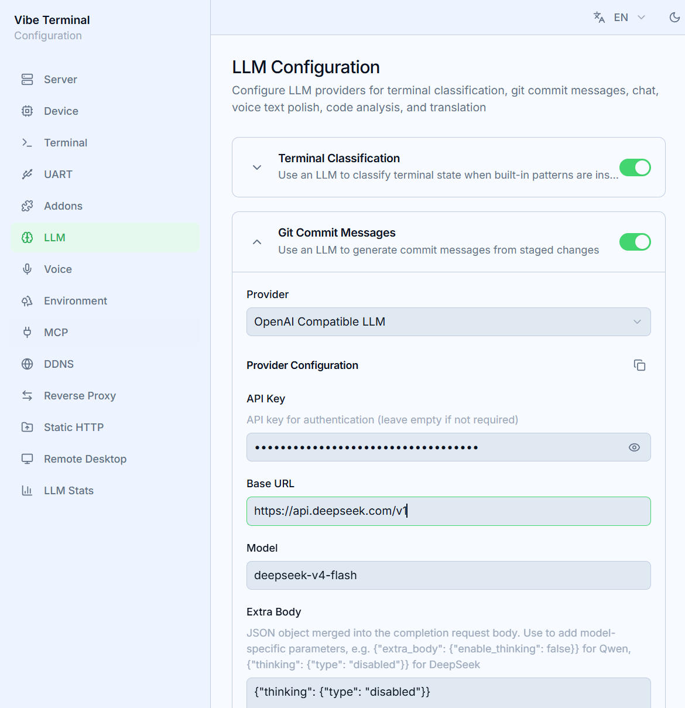
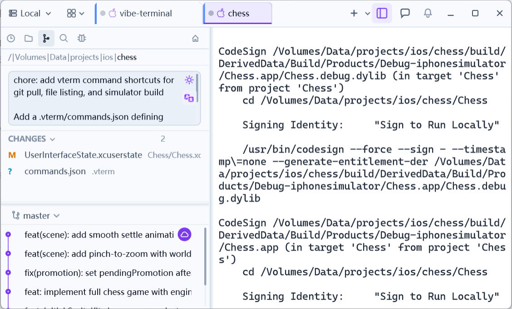

The Git panel's intelligence is LLM-driven: one-click commit messages, AI-assisted diff reading, and hunk-by-hunk agent conflict resolution. All of it relies on an LLM provider configured in the Web UI.

## Configuring the provider

Open the `LLM` section of the Web UI:

- Pick a `Provider` and fill in its credentials (the fields are defined by the provider's manifest); the configuration is global — terminal classification, Git commit messages, the chat assistant, and other AI features share the same provider;
- Providers are LLM-type addons: common ones are built in, and custom providers can be uploaded as a zip in the `Addons` section (the manifest declares the config fields the Web UI turns into a form).

## LLM features in Git

- **Commit message generation** — click the AI button next to the commit box; the LLM reads the staged diff and writes a message, typed into the box with an animation. The message stays editable — commit only when you're happy with it;
- **Diff analysis** — the sparkle button in the diff view header analyzes the current diff;
- **Conflict AI agent** — the rebase merge editor's AI mode resolves hunks one by one with explanations and confidence (see Resolving Conflicts).

> The LLM only reads repository content to produce text; commits and merges always happen when you confirm them.
