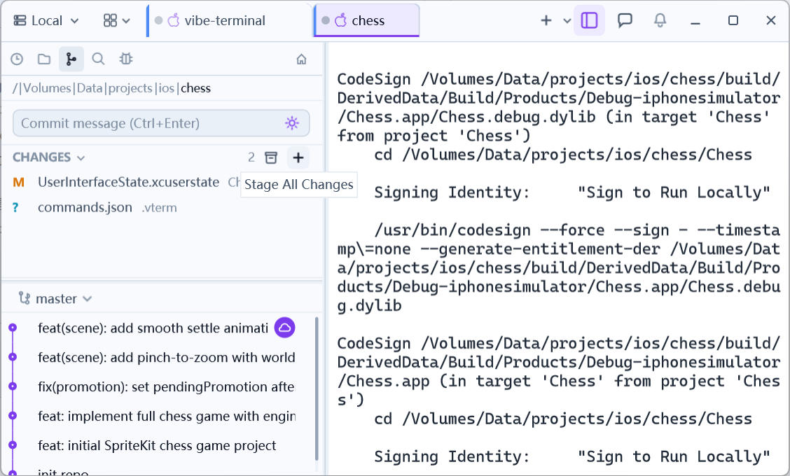

The Git panel builds version control into the client: stage, commit, manage branches, worktrees, interactive rebase, conflict resolution, and pushing — without leaving your terminal window. Everything operates on the Git repository of the current terminal session: whichever directory the session runs in is the repository the panel shows.

## Opening it

Click the `Git` tab in the left activity bar (repository data appears only when the active session is inside a Git repository). A tab's repository follows its active session; repository breadcrumbs let you hop between parent and child repositories, and submodules are listed separately.

## What it can do

- **Staging & committing** — per-file or bulk stage/unstage, discard changes, commit with a message, AI-generated commit messages (see LLM Assistance);
- **History** — commit history and per-file history, compare and revert between revisions;
- **Branches** — checkout, create, and delete local/remote branches and tags;
- **Worktrees** — check a branch out into an isolated working tree (a new terminal tab opens automatically), merge it back when done (see Worktrees);
- **Interactive rebase** — visually reorder/squash/edit the commit queue with conflict resolution (see Interactive Rebase);
- **Conflict resolution** — a merge editor with four modes, including an AI agent that resolves hunks one by one (see Resolving Conflicts);
- **Push & misc** — a full-featured push dialog, stashes, detached-HEAD handling (see Push, Checkout & More).

The following pages cover each area in that order.
