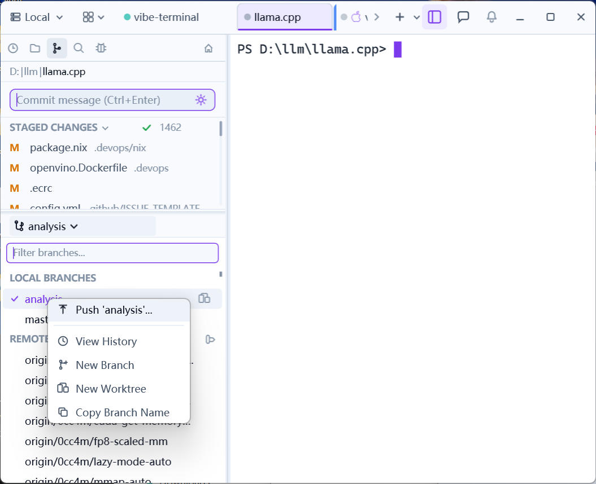
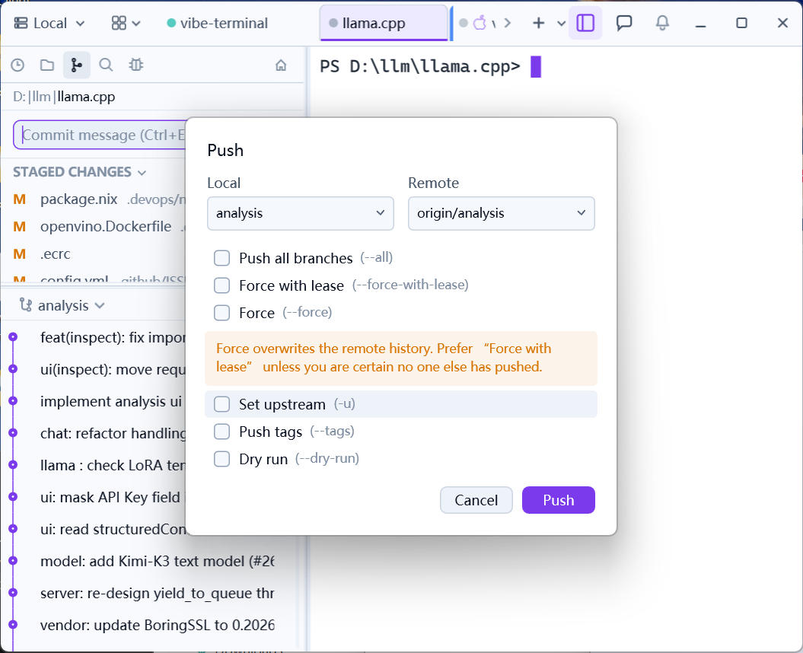
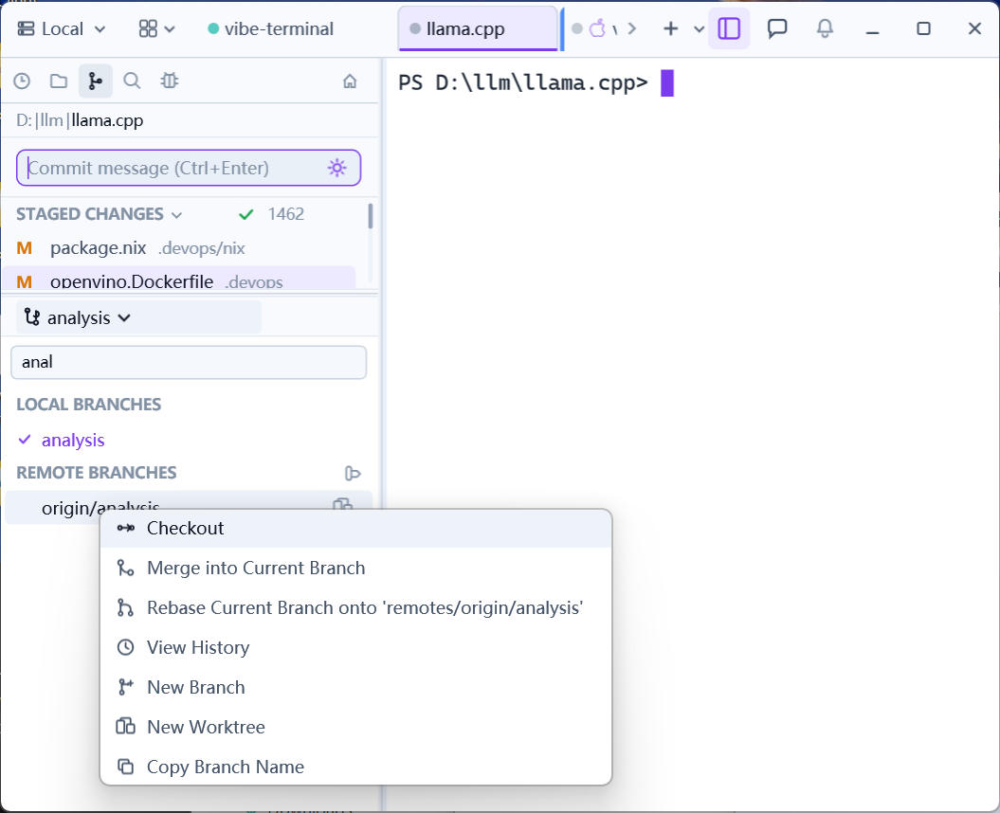
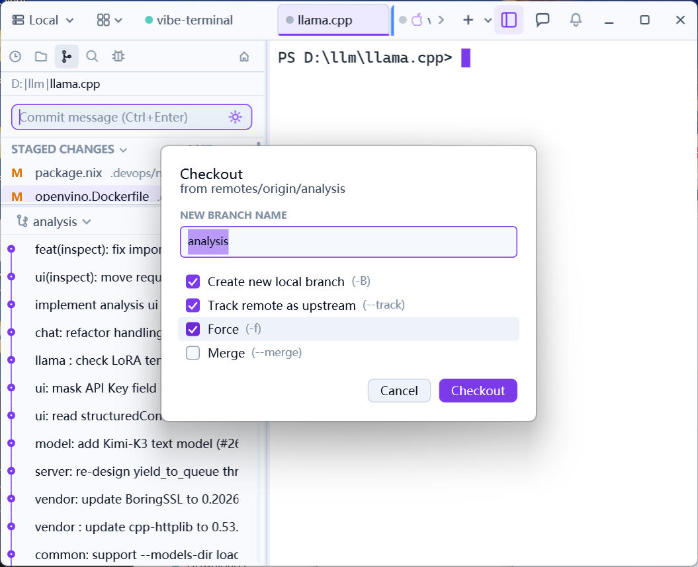

The branch list's right-click menu concentrates pushing, checkout, and the day-to-day branch operations.

## Push

Right-click a branch → `Push '{branch}'...` opens the push dialog:

- It shows the `local → remote` target mapping; either name can be changed (pushing to an existing remote branch under a different name asks for confirmation);
- Options: `Push all branches`, `Set upstream` (bind upstream on first push), `Push tags`, `Dry run`;
- History-rewriting `Force` and the safer `Force with lease` (refuses when someone else has pushed — preferred). Operations that rewrite history, like pushing after a rebase, require one of these;
- A risk hint about force pushes is shown in the dialog.

## Checkout

Right-click a branch → `Checkout` to switch branches — local branches check out directly, while a remote branch or tag opens the checkout dialog:

- `New branch name` — the local branch to create, prefilled from the ref;
- `Create new local branch` (`-B`), `Track remote as upstream` (`--track`, remote branches only), `Force` (`-f`), `Merge` (`--merge`).

The session's working directory follows the switch; the terminal and the Git panel reflect the new branch immediately.

## Detached HEAD

Checking out a bare commit (e.g. checking out a commit while browsing history) detaches HEAD. The next commit then opens the `Detached HEAD` dialog: choose an existing branch to commit to, `+ Create new branch…` in place, or `Skip` for now.

## More operations

- **Stash** — stash all changes onto the stack (message optional) from the changes header; the `STASHES` list supports `Pop` (apply and remove) and `Drop` (discard, irreversible);
- **Deleting branches/worktrees** — via the right-click menu on the entry, both with irreversible-action confirmations;
- **History & reverting** — `HISTORY` lists commits; right-click for file history, diff against the working tree, or revert to a revision;
- **Copy** — branch names and commit hashes copy in one click, handy for pasting to an agent or a colleague.
