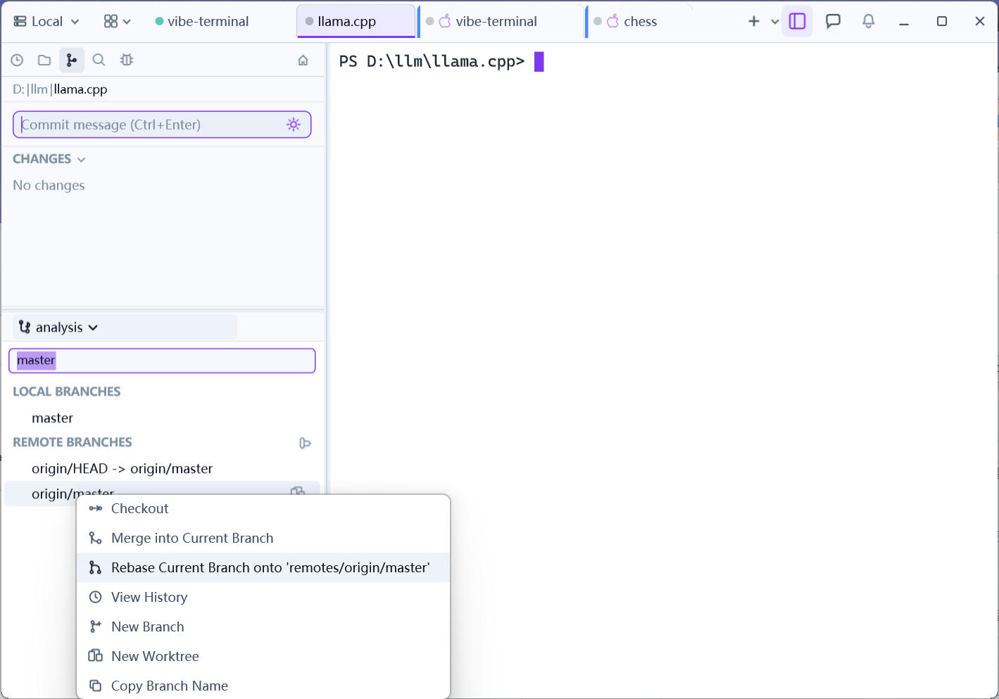
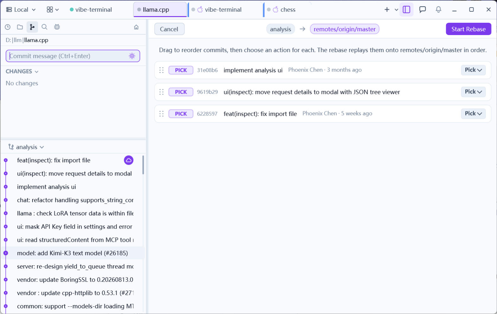
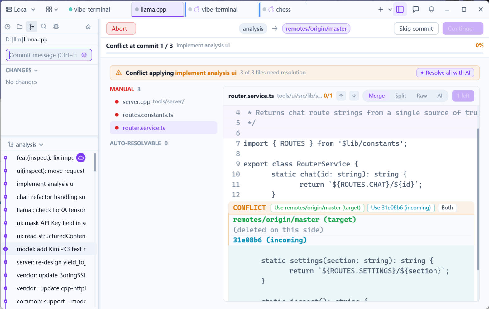
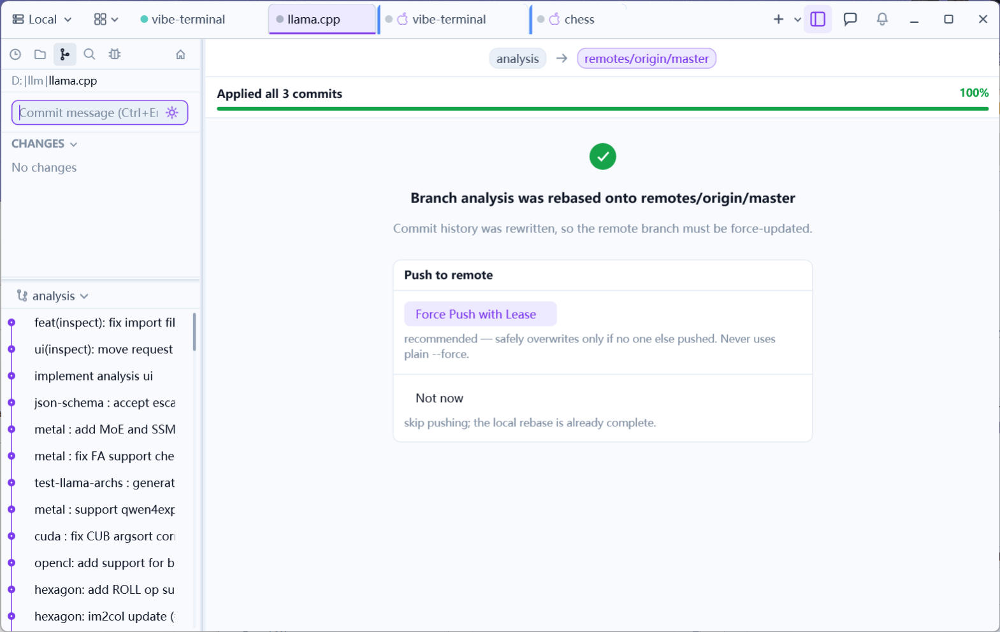

Interactive rebase turns `git rebase -i` into a visual flow: drag to rearrange the commit queue, apply commits one by one, resolve conflicts visually — no command line needed.

## Starting

Open the branch pane and type in the `Filter branches...` box to find the target branch, then right-click it → `Rebase Current Branch onto '{branch}'` to rebase the current branch onto the target. The panel switches to the rebase view, which moves through four phases:

## 1. Editing the commit queue

The commits on your branch that the target lacks form a queue:

- **Drag** to reorder them;
- Each commit has an action dropdown: `pick` (keep) / `squash` (fold into the previous, merge messages) / `fixup` (fold in, discard message) / `edit` (stop to amend) / `drop` (discard);
- Squashed and dropped commits collapse visually.

## 2. Applying

`Start Rebase` replays the queue onto the target commit by commit with a live progress bar; with no conflicts it runs straight through to done. `Abort` backs out at any time.

## 3. Conflicts (if any)

A conflict during applying switches to the conflict view — a file list plus the merge editor with its four modes (`Merge` / `Split` / `Raw` / `AI`), where each conflicted hunk gets its own decision (`Ours` / `Theirs` / `Both` …; see Resolving Conflicts). Once every file is resolved, `Continue` resumes the rebase.

## 4. Done

On completion the panel confirms `Branch '{branch}' was rebased onto '{target}'` and shows the push card — rebasing rewrote history, so the remote branch must be force-updated:

- `Force Push with Lease` — recommended: it overwrites only when no one else has pushed and never uses a plain `--force`;
- `Not now` — skip pushing; the local rebase is already complete.

> The session stays usable during the rebase; closing the panel does not interrupt a running one.
