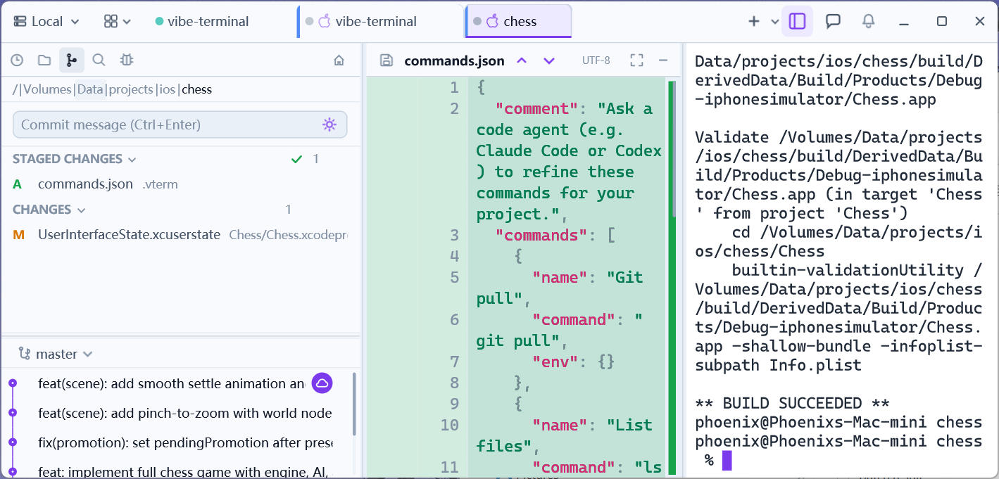
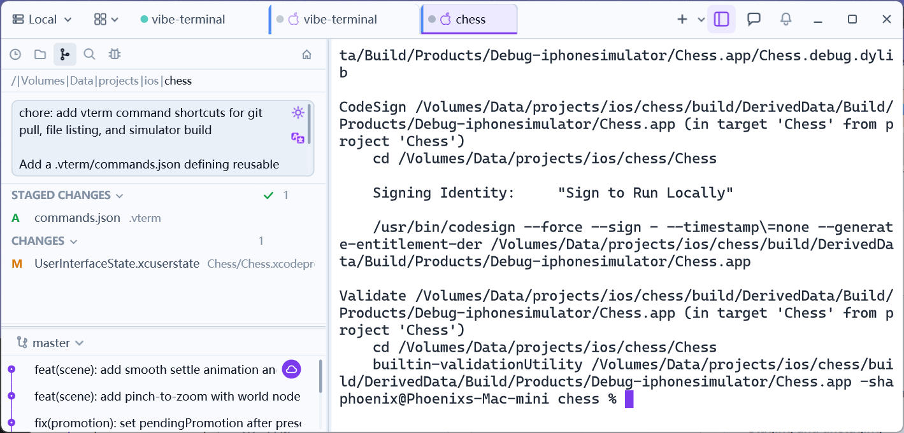
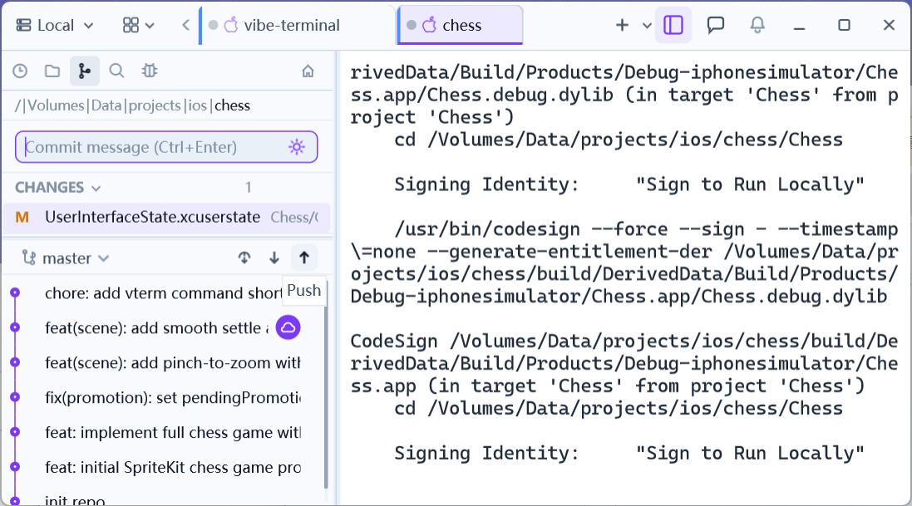
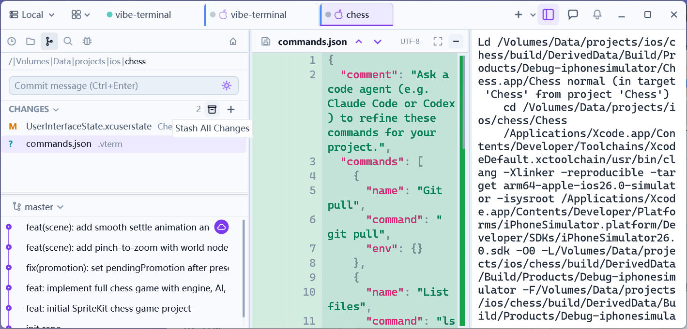
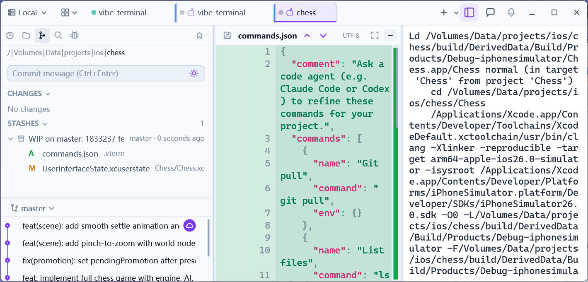
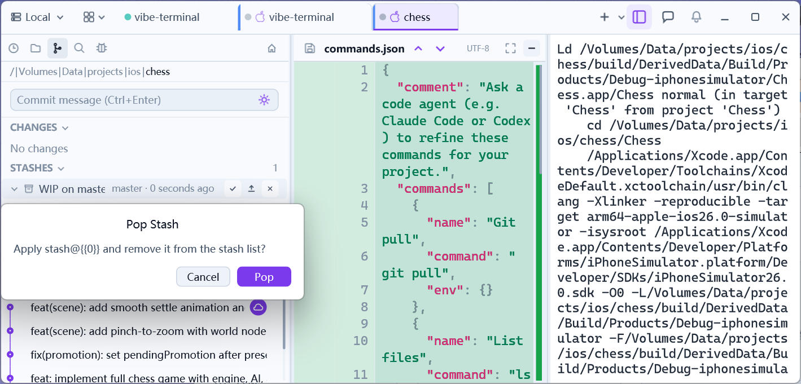

The Git panel's `CHANGES` area covers the everyday commit loop: review changes, stage, discard, stash, and commit with a message.

## Staging and unstaging

- Unstaged changes are listed under `CHANGES`, each file tagged with a status badge — `M` modified, `A` added, `D` deleted, `?` untracked, `!` conflict (submodule rows carry an extra `SUB` tag);
- Hovering a row reveals inline action buttons: `+` stages an unstaged file, `−` unstages a staged one, and `×` on an unstaged row discards it; the `Stage All Changes` / `Unstage All Changes` buttons in the section headers handle everything at once;
- `Ctrl`-click toggles files into a multi-selection and `Shift`-click selects a range — an action button then applies to every selected file;
- Clicking a file name opens its diff so you can review the change before deciding;
- Right-clicking a file offers `View File History`, `Stash This File`, `Copy Full Path` / `Copy Relative Path`, `Reveal in File Explorer`, and a `cd` shortcut that jumps the terminal to the file's folder.

## Committing

1. Stage what should go in;
2. Type a message in the commit box (`Ctrl+Enter` commits) or click the AI button to generate one (see LLM Assistance);
3. Click `Commit`.

After committing, hover the history header — the bar with the branch name above the commit history — and `Fetch`, `Pull`, and `Push` buttons fade in on its right. `Push` sends the current branch to its upstream right away; for options such as `Force with lease`, use the branch list's push dialog instead (see Push, Checkout & More).

## Stashing

- The archive button in the `CHANGES` header opens the `Stash All Changes` dialog, where an optional message describes the stash;
- Right-clicking selected unstaged files offers `Stash This File` (or `Stash <n> Selected Files` for a multi-selection) to stash just those paths — submodule rows are excluded;
- Stashes collect under `STASHES` as `WIP on <branch>` entries; expanding one lists the files it captured, and clicking a file shows its diff;
- Hovering a stash row shows `Apply` (restore and keep), `Pop` (apply and remove), and `Drop` (remove without applying) — `Pop` and `Drop` ask for confirmation first, and the right-click menu adds `View Diff`;
- The `STASHES` section stays hidden while the stash list is empty.

## Discarding

`Discard Changes` on an unstaged file throws away all uncommitted changes in it — there is a confirmation dialog and the action **cannot be undone**.

> A commit only includes staged content; unstaged changes stay in the working tree.
