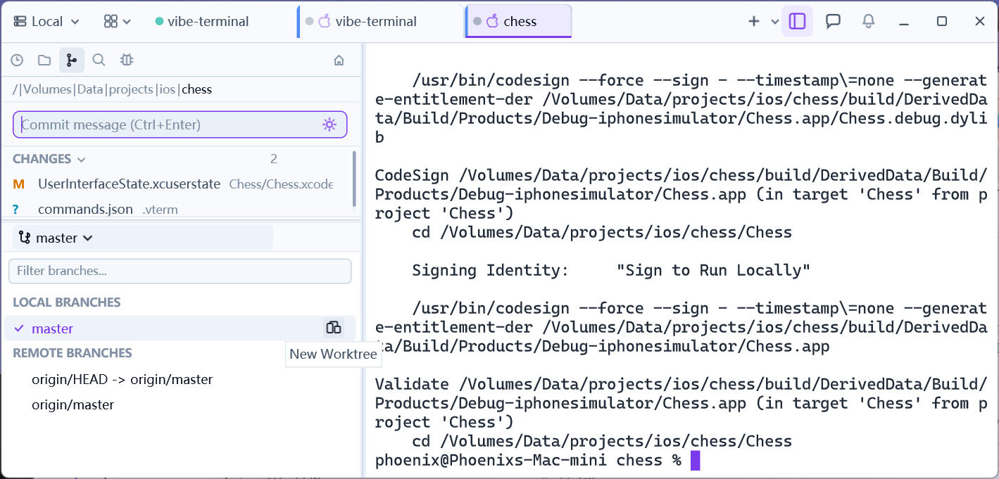
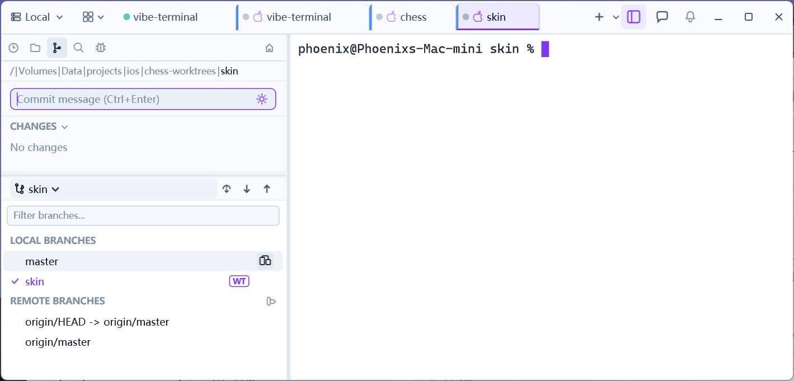
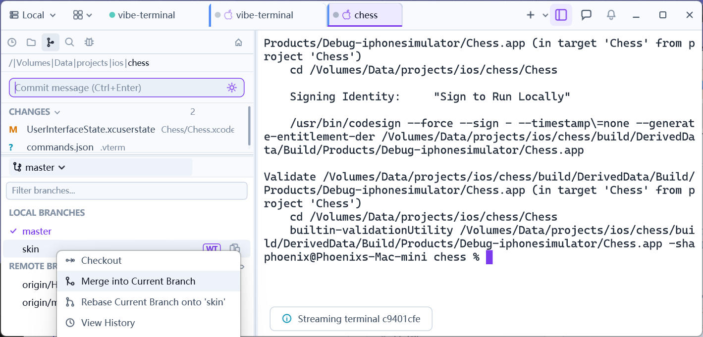
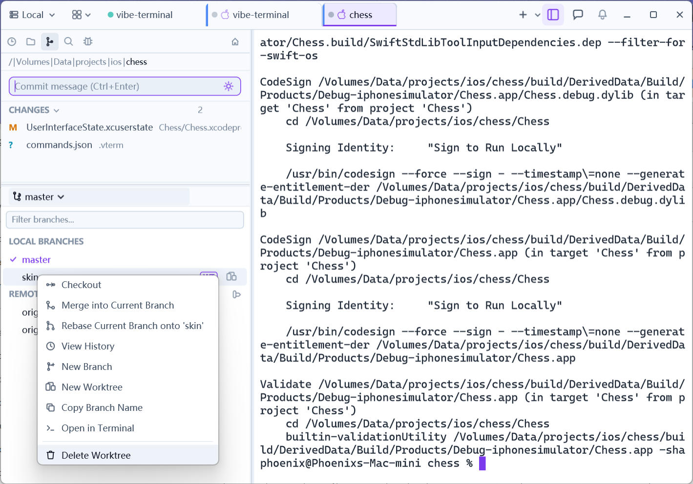

Worktrees check multiple branches of one repository out into separate directories: develop in parallel without touching the main working tree, then merge the branch back and clean up. Vibe Terminal turns the whole cycle into point-and-click.

## Creating a worktree

1. In the Git panel's branch list, right-click the target branch (a local or remote one) → `New Worktree`;
2. The dialog names the new worktree after the branch — edit it if you like; confirm, and the server creates the worktree directory and checks the branch out there;
3. **A new terminal tab opens automatically** with its working directory set to the new worktree — start developing in isolation immediately while the main working tree stays on its branch.

## Working in parallel

Every worktree is a fully independent working directory: builds and tests for the main branch and the feature branch run side by side in different tabs without interference. Branches checked out in a worktree carry a worktree marker showing their path in the branch list, and committing and pushing work right from the worktree's tab like on any branch.

Right-clicking a worktree branch adds two worktree-only entries: `Reveal in File Explorer` (local sessions) opens its directory in the system file manager, and `Open in Terminal` opens another tab there.

## Merging back and cleaning up

1. Commit and push inside the worktree's tab as usual;
2. Switch the main tab to the target branch (e.g. `main`), right-click the feature branch → `Merge into Current Branch` to bring the work over;

   

3. Once merged, right-click the branch → `Delete Worktree`: this removes the worktree directory and its branch together. Make sure everything is merged or pushed first — the dialog warns again and the action cannot be undone.

   

