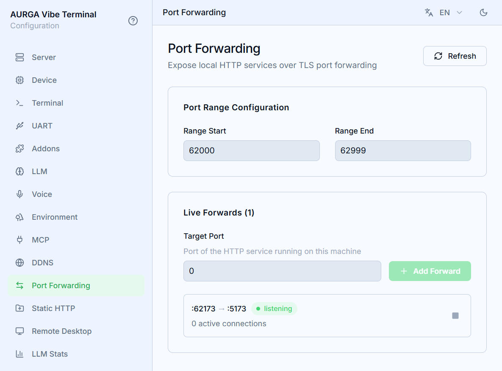
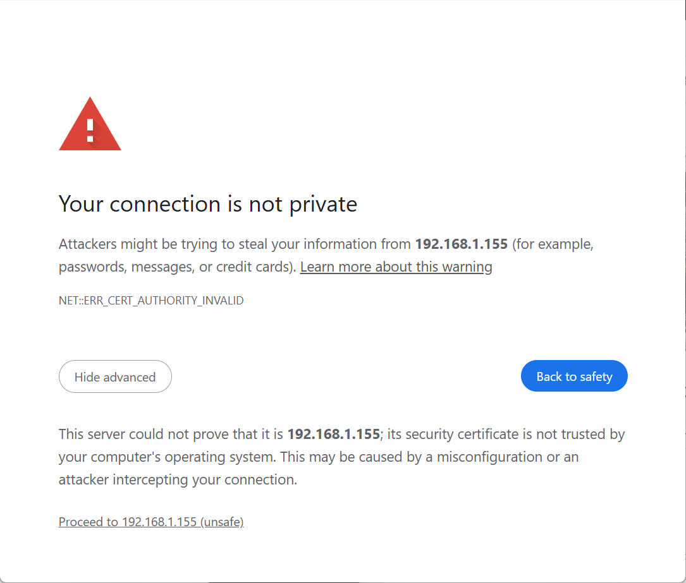

Port forwarding publishes an HTTP service running on the server machine — a dev server, a device dashboard, anything listening on a plain `http://localhost:port` address — on its own TLS port, so any device that can reach the server opens it in a browser as `https://<server-address>:<port>/`.

## How it works

- A forward maps a **target port** — the HTTP service on this machine — to a **forwarded port** allocated from the configured port range (default `62000`–`62999`);
- The forwarded port speaks TLS: all traffic is encrypted with the server's **self-signed certificate** — nothing travels in plain text, even over an untrusted network;
- Any device that can reach the server — on the LAN, or from the internet once the port range is forwarded on the router — opens `https://<server-address>:<forwardedPort>/` and lands on the local service.

Forwards are created on demand: the `Host with HTTP server` file share on a remote (relayed) server automatically requests one and hands you the ready-to-open URL. No manual setup is needed.

## Manage forwards

1. Open the `Port Forwarding` section of the server's Web UI.
2. `Port Range Configuration` bounds the pool forwarded ports are allocated from; changes save automatically. Narrow it when your firewall or router only forwards a few ports.
3. The live list shows each forward as `:forwardedPort → :targetPort` with its active connection count.
4. A forward's stop button tears the listener down immediately and disconnects its active connections; the next share allocates a fresh port. `Refresh` re-reads the list.

## The certificate warning

Forwards are encrypted with the server's own self-signed certificate — the same one that protects the Web UI and client connections. Browsers cannot verify it against a certificate authority, so the first visit to a forwarded URL shows a privacy warning (*Your connection is not private*). This is expected and safe to click through: the encryption itself is not compromised, only the certificate's origin cannot be machine-verified. To silence the warning permanently, import the server's certificate into your device's trust store.

## Chrome on macOS shows `ERR_ADDRESS_UNREACHABLE`

On macOS 15 (Sequoia) and later, third-party apps need explicit permission to reach devices on the local network — any `192.168.x.x`, `10.x.x.x`, or similar address. Safari is exempt as a system app, so a forwarded URL can open fine in Safari while Chrome reports `ERR_ADDRESS_UNREACHABLE` before TLS even starts. This is not a certificate problem and not a problem with the forward itself.

To grant Chrome access:

1. Open `System Settings` → `Privacy & Security` → `Local Network`.
2. Find `Google Chrome` in the list and turn it **on**.
3. Fully quit Chrome (`Cmd+Q`, not just closing windows) and relaunch it.

If the toggle is already on, switch it off and on again — it can get stuck after a Chrome or macOS update. If the error persists, check for a VPN or proxy extension in Chrome that does not route private address ranges.

## Access control

What guards a forwarded port depends on what is behind it:

- **Built-in shares are token-gated.** The share links the client generates — a `Host with HTTP server` share (`?share_token=…`) and the Server Settings page (`?ticket=…`) — carry an access token, and a connection with no valid token and no valid session is dropped before anything is served. On the first visit the token is exchanged for a secure session cookie scoped to that one service and is stripped from the URL, so it does not linger in the address bar or history.

- **The tokens are single-use and short-lived.** A settings ticket works exactly once and expires within a minute; when a share stops or restarts, its earlier links and sessions stop working. Treat the complete link as the credential — anyone holding it can access the service — and share it only with people you trust.

- **Your own services bring their own authentication.** A forward to any other local service encrypts traffic with the server's self-signed certificate but adds no authentication of its own: whatever the service serves — pages and APIs alike — is reachable by everyone who can reach the port. Put authentication in front of sensitive services before exposing them.
