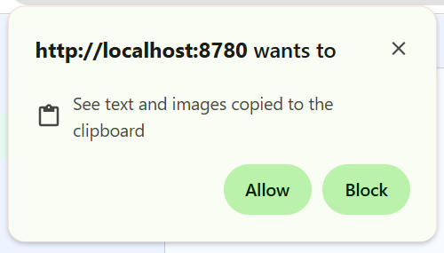
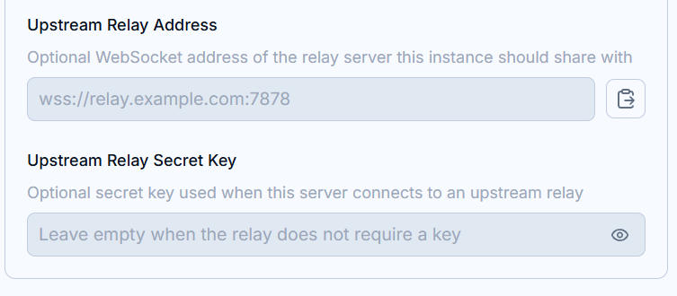
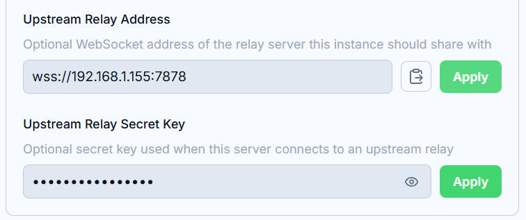
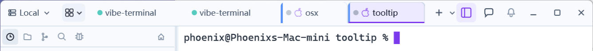
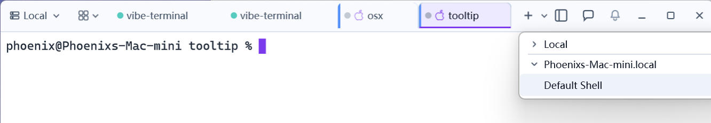
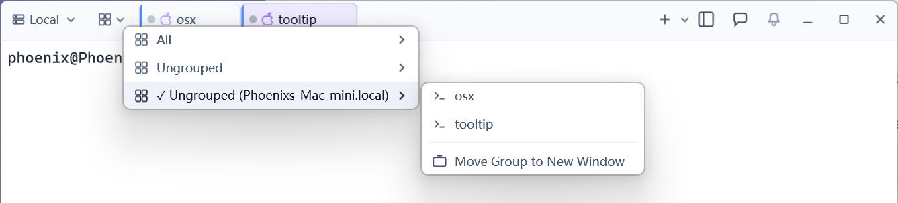

Connecting a machine to the relay takes two fields: the relay address and its key. See the previous page, Overview, for what the feature is and how the pieces fit together.

## Set up the relay server

1. Open the `Server` section on the machine that will act as the relay.
2. Make sure a `Secret Key` is set — the dice button generates one. The same key pairs both clients and shared servers.
3. Expand the `QR Code` block and pick the `Network Interface` / `IP Version` clients and shared servers should use to reach it.

## Connect a shared server

The relay's connection details travel on the clipboard — no retyping:

1. On the relay server's Web UI, click the `QR code`. This copies an encrypted share string (address, port, secret key) to the clipboard.
2. Open the Web UI on the machine being shared, `Server` section, and click into the `Relay Address` field.
3. The browser pops up a dialog asking whether to allow this site to access the clipboard — click `Allow`:

4. With access granted, the clipboard is checked: when it holds the share string, a paste button appears beside the field — click it to decrypt and auto-fill `Relay Address` and `Relay Secret Key`:

5. Review the values and click `Apply` — saving reconnects the upstream relay.

> Reading the clipboard requires a secure context (HTTPS or localhost). On plain HTTP the paste button stays hidden; type the relay address and key in by hand instead.

By default the upstream connection is encrypted but not verified. To also pin the relay's certificate, see Strict Verification on the Relay under Certificates & TLS.

## Desktop client

### Shared-server tabs

Tabs of terminals running on a shared server carry two markers: a colored stripe on the tab's left edge — one color per server — and the remote OS icon (Windows / Apple / Linux) beside the status dot. Local tabs on the relay server itself have no markers.

### Terminal profiles per server

The profile menu (title bar) groups terminal profiles by server: the connected relay server's own profiles first, then one collapsible group per shared server, named after the machine. Expand a group and pick a profile to open a terminal on that server. The menu follows the tab group selected in the title bar.

### Grouping and separate windows

The title-bar group selector lists the tab groups of every server; a shared server's default group shows as `Ungrouped (Server Name)`. Each group's submenu lists its tabs for quick switching and offers `Move Group to New Window`, which tears the whole group off into its own window — useful for dedicating a window or monitor to one machine.

