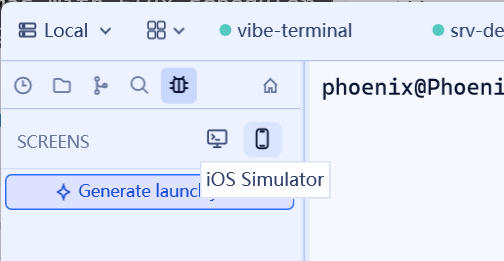

The desktop client opens remote screens from the SCREENS bar at the top of the Debug panel. Every screen lives in its own floating window you can use alongside terminals.

## Opening the SCREENS bar

1. Connect to the target server (directly or through a relay);
2. Click the `Debug` tab in the left activity bar (the tools icon);
3. The `SCREENS` bar appears at the top of the panel: one display button per physical desktop screen on the server, followed by the `iOS Simulator` and `Android Simulator` toggles.

## Desktop screen windows

Click a display button to open that screen's window:

- The window is freely resizable (down to 800×600) and the picture re-lays out with it;
- Multi-monitor servers get one window per display; several can be open at once;
- While connecting, the window shows a "preparing desktop" placeholder; if the server lacks capture permission, the window shows the platform's permission instructions directly;
- Click the bar button again or close the window to stop watching (the button's active state stays in sync with the window).

## iOS simulator window

Click `iOS Simulator` to open a fixed-size phone-framed window (264×640 portrait):

- The device picker at the top switches the phone appearance; the window re-fits to the selected resolution;
- `Rotate` flips portrait/landscape (524×380 landscape window);
- Requires a macOS server running the Xcode iOS simulator.

## Android emulator window

`Android Simulator` works the same way: fixed phone frame, device picker, rotate button. Streamable sources include running AVD emulators and connected real devices; an AVD can also be booted or shut down on demand from the client (see Android Devices).

> Windows streaming a localhost server are automatically excluded from screen capture to avoid a feedback mirror; windows streaming a remote machine stay capturable so an outer recording still shows them.
