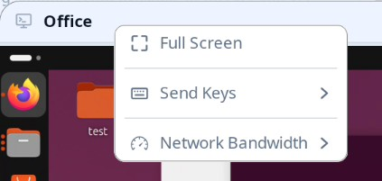
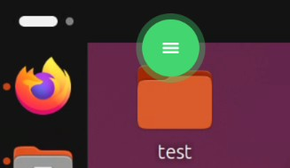
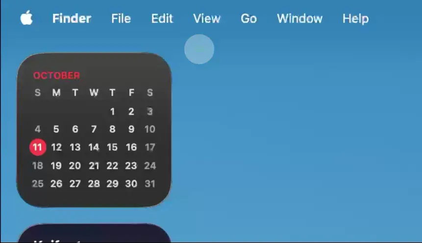

The desktop screen window has a borderless fullscreen mode for longer viewing sessions: the title bar disappears and the streamed video covers the whole window. This page covers fullscreen and the floating menu button that stands in for the title bar's menu; see Using the Client for how screen windows are opened in the first place.

## Fullscreen mode

- Double-clicking the title bar toggles fullscreen (same as the maximize button); the title-bar right-click menu has a `Full Screen` entry too;

  

- On entry the floating menu button (below) plays a short attention animation so you can spot where it sits;
- On exit the title bar and its right-click menu come back, and the button disappears.

While fullscreen every physical key is forwarded to the remote host like any other key: no keyboard shortcut is reserved locally. To leave fullscreen, use the floating menu button's `Exit Full Screen` entry.

## The floating menu button

Fullscreen hides the title bar — and with it the right-click context menu — so a small round button with a hamburger glyph floats near the top center of the window:

- Click it to open the same menu the title bar offered — exit fullscreen, send keys, network bandwidth — anchored right below the button;
- Press and drag it anywhere inside the window;
- While idle it dims to 30% opacity to stay out of the video; hovering or pressing it restores full opacity.

## Locating the faded button

Over bright video the dimmed idle button can be hard to find again. Left-click quickly **four times** anywhere in the window — four presses within one second — and the button replays its entrance animation: an accent-colored plate with a white glyph pulses three times, each pulse sending out an expanding ring, then it settles back to its idle dimness.

Details worth knowing:

- Presses on the button itself don't count toward the burst (neither do the title bar or an open menu, outside fullscreen);
- The four presses are still forwarded to the remote desktop as ordinary clicks meanwhile — aim them at an empty spot of the desktop;
- Entering fullscreen always replays the animation once, so the reveal gesture is mainly for finding the button again later.

