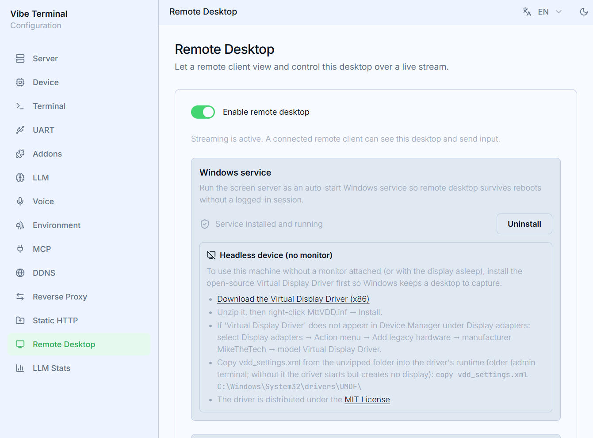
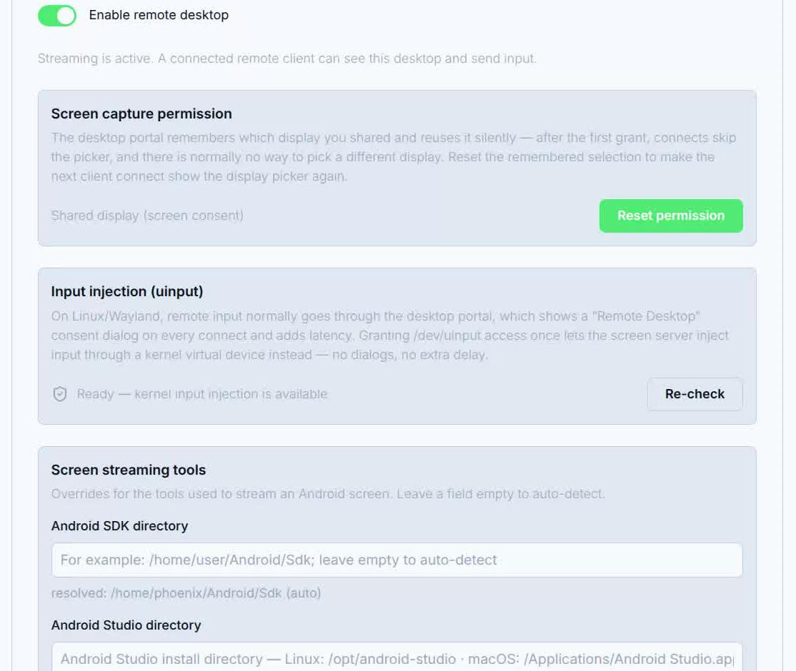
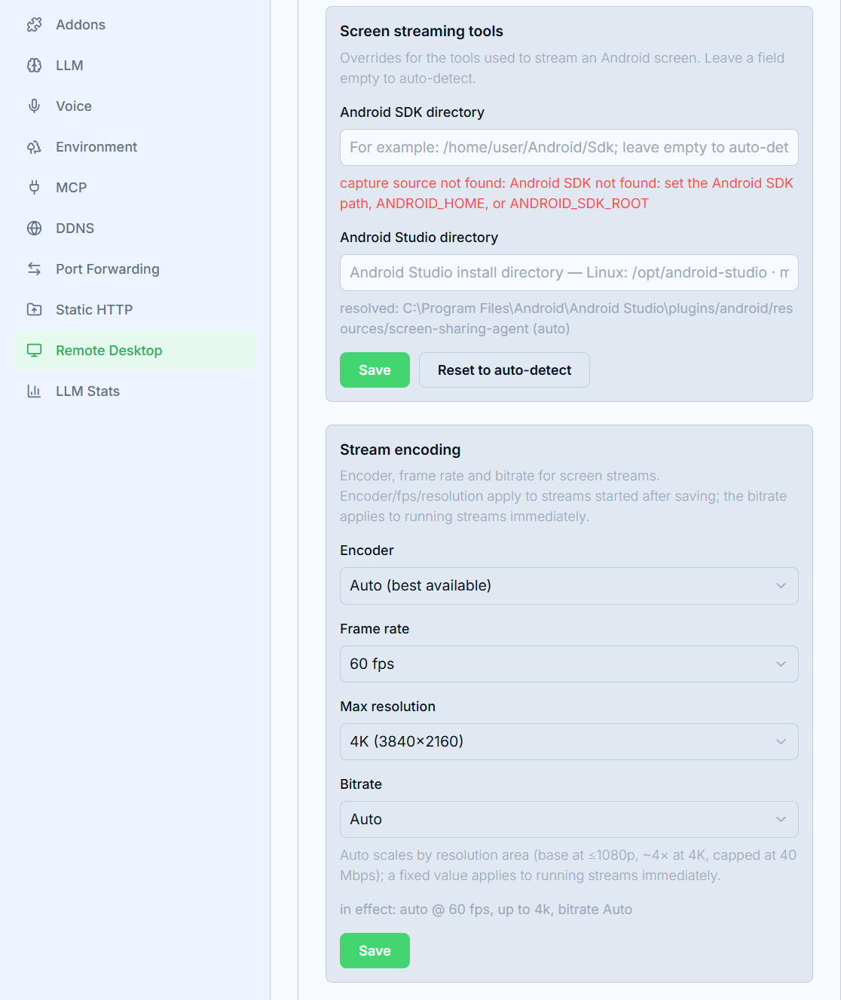

Everything lives in the `Remote Desktop` section of the Web UI; the page shows the settings that apply to the server's platform.

## Main switch

`Enable Remote Desktop` — once on, connected remote clients may view this machine's desktop and send input.

## Platform settings

**Windows**

- `Windows Service` — registers the screen server as an auto-start system service so remote desktop survives reboots without a logged-in session. `Install` / `Uninstall` trigger a UAC prompt on the server (the button shows progress while waiting); the status badge distinguishes running / installed / not installed.
- `Headless machines (no monitor)` — without an attached (or awake) display Windows keeps no capturable desktop. The page links the open-source Virtual Display Driver download (ARM64 / x64 picked automatically); install it so a virtual desktop always exists.

**Linux**

- `Unlock on Connect` — automatically unlocks the locked session when a stream starts (where the environment supports it);
- Screen capture goes through the Portal; the `Screen Recording Permission` card's `Reset Permission` clears a saved Portal consent so you can pick a different screen.
- `Auto-start on Login` (in the `Server` section) — on hosts with a display manager the server starts together with the graphical session, so capture inherits the full desktop environment; on headless hosts it starts at boot before any login instead. To reach the desktop when nobody has logged in locally, also enable automatic login in the display manager (GDM, SDDM, …); for security the automatic screen lock can stay on — the session and server keep running while locked, and `Unlock on Connect` (or `loginctl unlock-session`) opens the session remotely.

**macOS**

- `Screen Recording Permission` — the system requires explicit approval for capture. Click `Grant Permission` to open the system dialog; `Reset Permission` recovers from a stuck state.

## Screen streaming tools (Android support)

`Android SDK directory` and `Android Studio directory` locate adb and the emulator; leave empty for auto-detection. Once set, the page shows the resolved path and where it came from (auto / env / override); `Reset to Auto-Detect` restores the default. See Android Devices for what these enable.

## Stream encoding

- `Encoder` — Auto or a specific backend; the server lists usable encoders and greys out unavailable ones with the reason;
- `Frame rate` — 60 / 30 / 15 fps;
- `Max resolution` — capture-side ceiling (4K / 2.5K / 2K);
- `Bitrate` — `Auto` area-scales with resolution (base rate up to 1080p, ~4× at 4K, capped at 40 Mbps); a fixed value applies to running streams immediately, while encoder / fps / resolution apply to streams started afterwards;
- The card footer shows the encoder / fps / resolution / bitrate currently in effect.

Click `Save` to apply changes.
