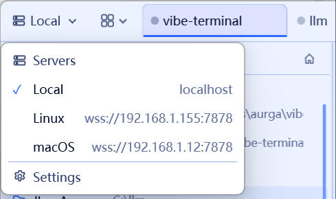
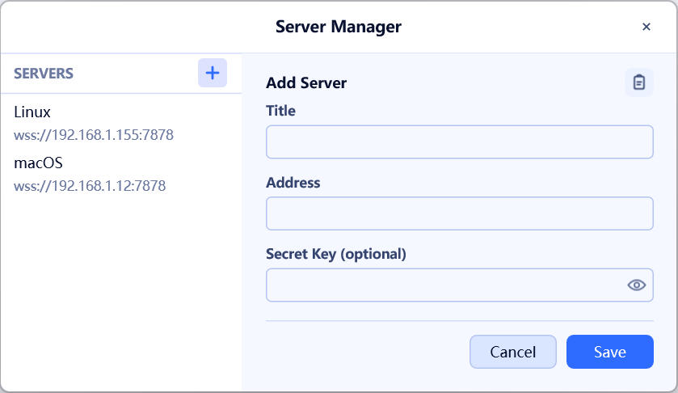

Connect a client to this server with the pairing QR code from the Web UI — or by typing the details in by hand. Everything a client needs (address, port, secret key) is shown in the Server section.

## Prepare the server

- Open the `Server` section and make sure a `Secret Key` is set; click the dice button to generate one. Regenerating the key invalidates every paired client, which must pair again.
- Expand the `QR Code` block and choose the `Network Interface` and `IP Version` (IPv4 / IPv6) that other machines should use to reach this server.
- If a DDNS domain is configured, you can switch `Connection Type` to the `DDNS Domain` so the QR code embeds the domain instead of an IP address.
- The `Pairing Preview` shows the exact Connection URL (`wss://host:port`) that the client will dial.
- Clicking the `QR code` copies an encrypted share string to the clipboard — the clients use it for one-tap autofill.

## Desktop client

- Click the server-name button in the title bar and choose `Servers` in the menu to open the Server Manager dialog.

- Click the `+` button beside the server list to start the Add Server form.
- If the share string is on your clipboard, a clipboard icon appears in the top-right of the form — click it to decrypt the string and auto-fill `Title`, `Address` and `Secret Key`.
- Otherwise fill in the fields by hand: a display name, the connection URL (`wss://host:port`, IPv6 addresses in brackets) and the secret key.
- Click `Save`, then pick the new server to open a session.

