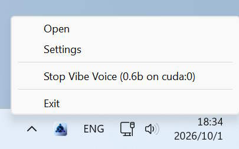

Vibe Terminal is a remotely managed terminal hub for embedded and server development. One **server** runs on each machine you work on — a dev box, a build server, an embedded board — and **clients** connect to it from a desktop app or the command line. This guide covers both sides: the Web UI that configures a server, and the clients that work with it.

## How it fits together

- Everything runs on the **server** — terminal sessions live there, so closing a client, dropping the network or rearranging windows never interrupts a running command; reconnect and pick up where you left off;
- Clients dial a single encrypted WebSocket connection (`wss://host:port`; `wss://localhost:5153` for the local server) and authenticate with the server's **secret key**; pairing hands the key over through a QR code or encrypted share string (see Connecting a Client);
- The **Web UI** is the server's own configuration page — profiles, addons, LLM providers, relay, port forwarding and more. It is not a terminal: day-to-day work happens in the desktop client or `vtermc`.

## Components

- **Server** — runs on the target machine; hosts the terminal sessions and serves files, Git, remote desktop, voice and AI features to connected clients;
- **Desktop client** — the native workspace: terminals with splits, tab groups and detached windows, a file explorer and editor, Git tools, voice input, code agent conversation history, remote desktop and remote debugging;
- **`vtermc` CLI** — launch and attach to sessions from any plain terminal, over SSH or on a headless machine; shares its server list with the desktop client (see Command-line Client);
- **Web UI** — browser-based settings for the server itself, organised into sections in the left sidebar (see Using the Web UI).

## Tray icon

On machines with a desktop session, the server shows a tray icon while it runs:

- **Open** — brings a running desktop client to the foreground, or launches one when none is running (double-clicking the icon does the same);
- **Settings** — opens the server's Web UI in the browser (see Using the Web UI);
- **Start/Stop Vibe Voice** — starts or stops the voice server without opening the Web UI, mirroring the `Voice` section's Start/Stop buttons; it appears when voice recognition is enabled, and the label tracks the state (e.g. `Stop Vibe Voice (model on device)` while the model is loaded);
- **Exit** — shuts the server down.

While folders are hosted over HTTP, an `HTTP Servers` entry offers a one-click stop for each share (see Host with HTTP Server).

## Feature map

The rest of this guide mirrors the sidebar chapters:

- **Terminals** — creating, splitting and organising terminals; profiles, WSL and UART serial; quick commands and environment variables; driving terminals from external agents with MCP; reviewing code agent conversations; auto-confirming interactive prompts;
- **Files** — recent projects, the server-side file explorer, upload & download, and hosting a directory over HTTP (see File Explorer, Upload & Download and Host with HTTP Server);
- **Git** — staging, AI-assisted commits, worktrees, interactive rebase, conflict resolution and push;
- **Remote Desktop & Simulator** — watching and controlling the server's screens, Android devices and emulators, and the iOS simulator;
- **Voice Input** — server-side speech recognition with push-to-talk dictation and LLM polish;
- **Relay** — reaching machines behind NAT or dynamic IPs through a single public entry point;
- **Remote Access** — DDNS domains and TLS port forwarding for services running on the server;
- **AI Features** — LLM providers as addons, assigned per feature, plus MCP integration (see LLM and MCP).

## Where to start

1. Open the Web UI's `Server` section, set a `Secret Key`, and pair a client — Connecting a Client walks through the QR-code and manual setup;
2. Browse the Web UI sections to configure profiles, addons and features — see Using the Web UI;
3. Open a terminal on the server and work through the chapters above as needed.
