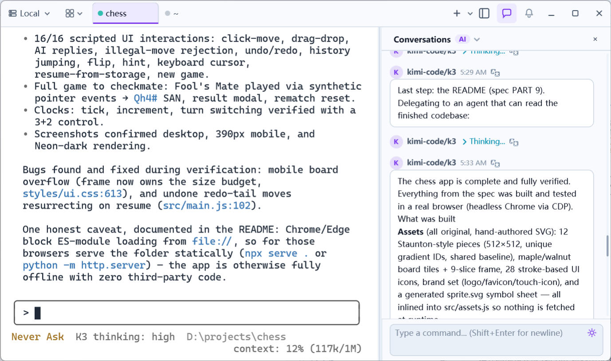

When you run a code agent (Claude Code, Codex, Kimi, Pi, OpenCode…) in a terminal, its conversation is trapped in that terminal window — scrolled among command output, gone once the screen moves. `Code Agent Conversation History` lifts the full conversation into a dedicated panel: every exchange shown structured, past conversations switchable, messages translatable — and you can send commands to the terminal right from the panel.

## Opening the panel

Click the chat (`AI`) button on the right side of the title bar to toggle the Copilot panel. The dropdown at its top lists **all past conversations** of the agent running in the active terminal session, newest first; picking one loads it.

## How it works

- The server knows which agent app is running in the terminal and parses its **native session files** (each agent's JSONL/history format under its project directory); changes to the file stream in live, keeping the conversation view scrolling up to date;
- Supported agents: `claude` / `codex` / `kimi` / `pi` / `opencode`; other apps have no conversation panel yet;
- Messages carry a role (you / agent) and a type (text / **Thinking** reasoning), along with the model name and time, rendered as Markdown.

## Panel features

- **Switch conversations**: the `Conversations` dropdown at the top moves between past sessions, each entry showing a brief and its time;
- **Translate**: any agent message can be translated on request; the translation replaces the text in place (and can be toggled back);
- **Send commands directly**: type in the box at the bottom (Shift+Enter for a newline) and press Enter — the command goes straight into the current terminal, like typing into the agent's own input box without occupying the terminal view.

## How it fits with other features

- The panel and the terminal are two views of the same session: the agent's questions in the terminal are still answered there (or via Auto Confirm); the panel is for reviewing history, not for intercepting interaction;
- Combined with `Terminal MCP` (previous page), external agents can also read the terminal screen and run commands — the conversation shown here plus MCP actions form the complete record of agent work.
