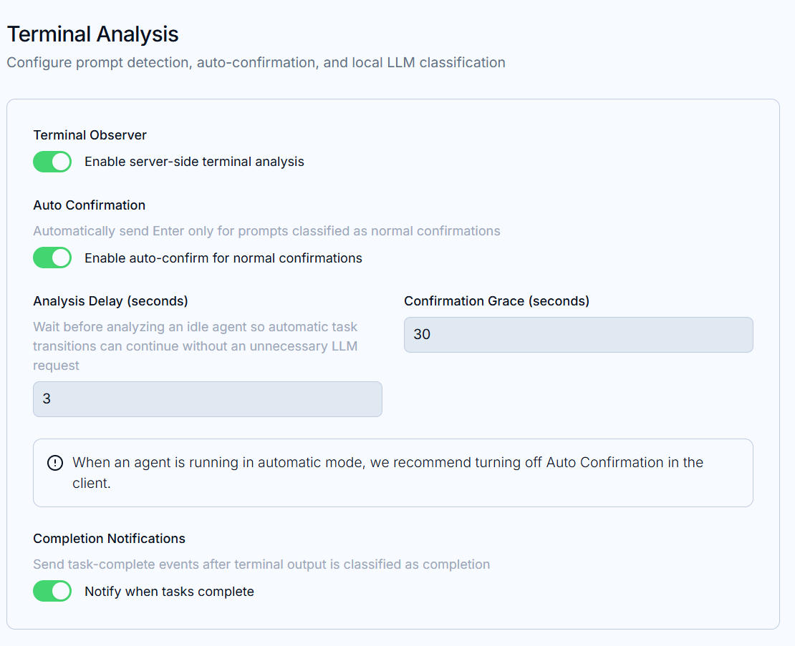
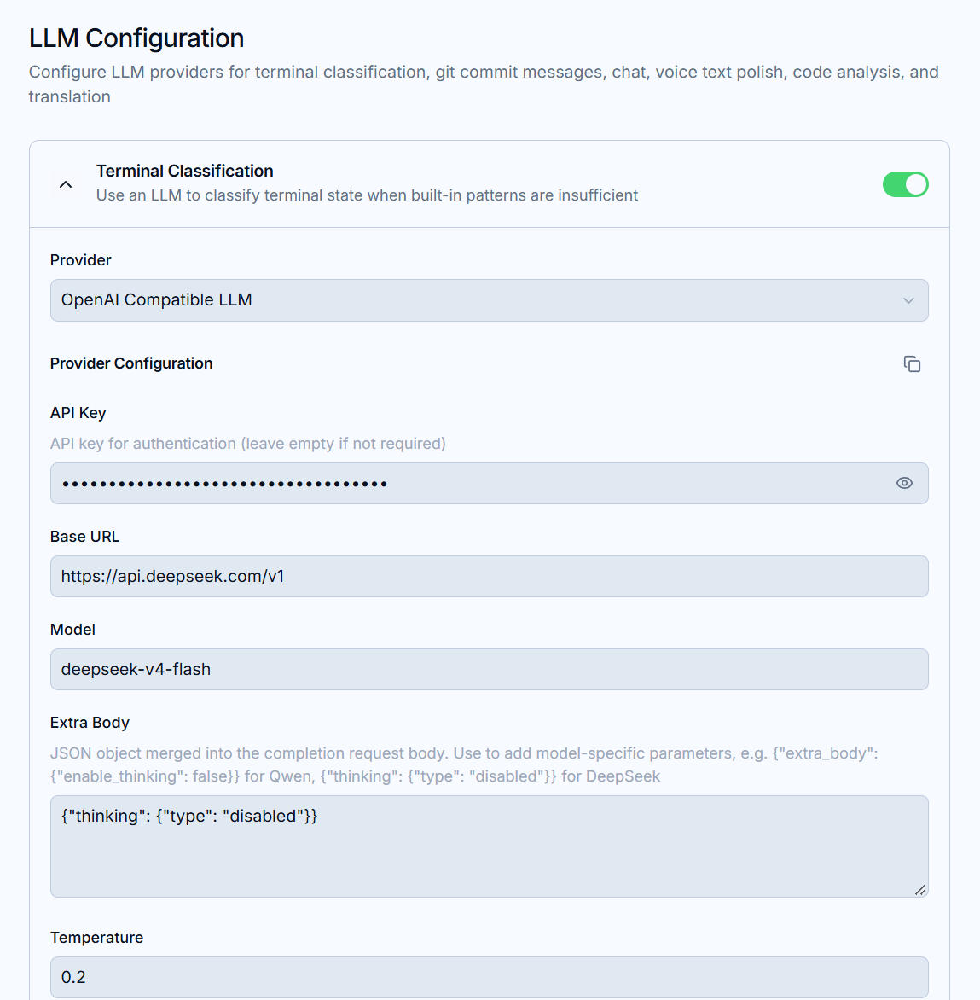

The server-side terminal analyzer watches terminal output: it detects command prompts, recognizes task completion, and with an LLM classifies what the terminal is showing. `Auto Confirm` is its most used feature — when the terminal stops at an ordinary confirmation prompt (like `Proceed? [Y/n]`), Enter is sent for you, so long tasks no longer stall on questions.

## Configuration

The `Terminal Analysis` section of the Web UI:

- `Terminal observer` — the master switch for server-side analysis;
- `Auto confirm` — sends Enter only for prompts classified as **ordinary confirmations**; other questions are never answered blindly;
- `Analysis delay (seconds)` — how long to wait after an agent goes idle before analyzing, avoiding redundant LLM calls between tasks;
- `Confirmation grace (seconds)` — the window during which you can take over after a confirmation is detected;
- `Notify on completion` — emits an event when output is classified as task-finished (feed it into notifications).

> The page notes: when your agent's own auto mode is on, prefer turning `Auto confirm` off in the client so the two automations don't answer over each other.

## LLM dependency

Classification is done by an LLM: pick a `Provider` and fill in its credentials in the `LLM` section (shared by terminal classification, Git commit messages, the chat assistant, and other AI features). Without an LLM the analyzer still works with reduced accuracy — keep auto confirm off in that case.

