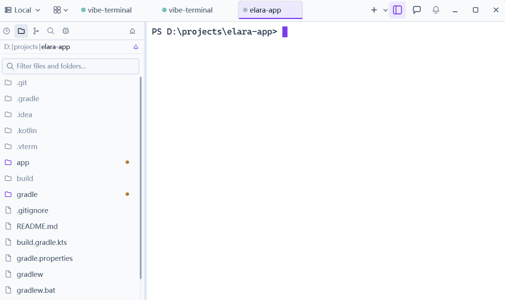

Quick Commands pin a project's build/test/deploy commands into the terminal's right-click menu — one click to run, available everywhere. Commands are maintained per repository in `.vterm/commands.json` at the repository root.

## Creating commands.json

Right-click inside a terminal → `Commands`:

- When the session's repository has no commands.json yet, the menu offers a single entry, `Generate commands.json` — clicking it makes the server detect the project type (npm / Cargo / .NET / Xcode / Gradle-Android / generic) and write a conservative starter template. An existing non-empty file is **never overwritten**;
- File location: `.vterm/commands.json` in the Git repository root (the current working directory for non-Git folders).

## Refining

The generated template only contains the usual commands for the detected project type. Let your code agent (for example an editor agent connected to this server's MCP) read the project and refine the file:

```json
{
  "commands": [
    { "name": "Build", "command": "cargo build --release" },
    { "name": "Test verbose", "command": "cargo test -- --nocapture",
      "env": { "RUST_LOG": "debug" } },
    { "name": "Package (Windows)", "command": "./packaging/windows/package.bat",
      "os": "win" }
  ]
}
```

A top-level array is accepted too; `env` is optional and sets variables before the command runs; the legacy `value` key is still read. The optional `os` field limits an entry to the operating system running `vterm-server`: use `"win"` for Windows, `"linux"` for Linux, or `"osx"` for macOS. If `os` is omitted, set to `"all"`, or set to an unrecognized value, the entry is available on every platform. The server watches CWD and commands.json changes and broadcasts them — reopen the menu and the new commands are there.

## Running

Right-click → `Commands` → click an entry to run it in that terminal (optional env applied first). The menu is unavailable while an agent app is running in the session, so command text can't land inside the app's UI.

## Example: Android build & install over Wi-Fi

A complete walk-through on a Gradle-Android project: pin the wireless-ADB setup and the build-and-install flow into the right-click menu, then rebuild the app with one click.

**1. Switch the phone to wireless ADB.** These two commands are typed once per device — `adb tcpip 5555` while the phone is on USB, then `adb connect` with the phone's address:



**2. Let the code agent write the commands.** Open the project's code agent (here Claude Code) in a terminal and ask it to add build & install commands — it reads the project layout and writes the entries into `.vterm/commands.json`:


**3. Build and install from the menu.** Split the terminal so the build output gets its own pane, then right-click → `Commands` → the entry — Gradle assembles the APK and installs it on the phone over Wi-Fi:


