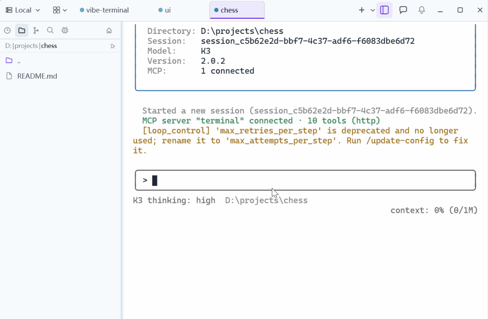

Code agents (Claude Code, Codex, Kimi, Pi, OpenCode…) only know what reaches their input. `Adding Context` is how you hand them file paths and code snippets without retyping: drag files from the `Explorer`, or drag selected text from the code editor and the git diff view, straight into the agent's terminal or the Copilot chat input.

## Dragging files in

Press a file — or a multi-selection — in the `Explorer` file list and drag it:

- **Onto a terminal**: the full path(s) are typed at the drop point, space-separated, ready to become part of your next prompt to the agent;
- **Onto the Copilot chat input**: the paths are inserted into the message draft, one per line, so you can assemble a multi-file prompt before sending.

Paths dragged in from your OS file manager and dropped on a terminal are quoted automatically, so names containing spaces survive intact.



## Dragging selected code as context

Select text in the code editor or in a git diff, then press the selection itself and drag it onto a terminal:

- When the terminal is **running a code agent**, the drop inserts a *context block* — the file path, the line range, and the snippet wrapped in a code fence:

````text
File: crates/vterm/src/ui/terminal_view.rs
Lines: 558-566
```
fn can_accept_native_drop(&self, info: &DndInfo) -> bool { … }
```
````

- When the terminal is at a **plain shell prompt**, the drop types the raw selected text instead, so the same gesture works for ordinary commands too;
- When the diff is viewed at a specific commit, the block additionally carries a `Commit:` line pinning the exact revision.


## Copy Context

The same block lives on the right-click menu: `Copy Context` in the code editor and the diff view copies it to the clipboard. Paste it into the Copilot chat input — or into any other agent — when dragging is inconvenient. The animation above shows the resulting block in the agent's input.

## Tips

- Multi-select in the `Explorer` to drop several paths at once;
- The Copilot chat input sends straight into the terminal like typed input (see `Code Agent History`), so context added there reaches the agent exactly as if you had typed it;
- Combine with `Auto Confirm` to let the agent act on the dropped context without further prompts.
