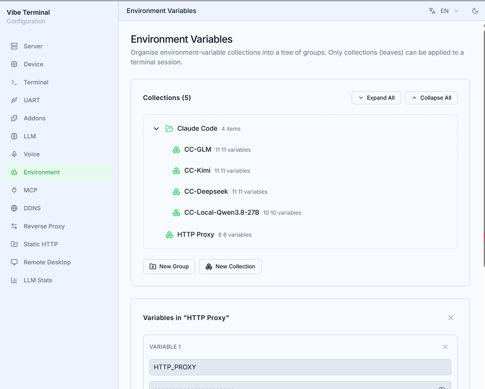

Environment variables let you maintain grouped sets of variables per project (`ANDROID_HOME`, API keys, proxy settings) and apply or clear them on any terminal session with one click. They live in the server config; values are encrypted at rest.

## Maintaining in the Web UI

The `Environment Variables` section organizes them as a tree:

- **Groups** — pure containers, nestable (right-click → `New Group`), for organizing by project or scenario;
- **Collections** — the leaves of the tree and the actual variable holders (`New Leaf`); only collections can be applied to a terminal;
- Each collection's key/value pairs are edited via `Edit Variables` (`Add Variable`); values are hidden by default;
- Collections can be duplicated to derive variants (the same set with one key changed).

## Applying to a terminal

Right-click inside a terminal → `Envs`:

- The submenu mirrors the tree from the Web UI; expand a collection and choose `Apply` to inject its variables into the current session, or `Clear` to remove them again;
- Newly started processes see the variables (already-running foreground programs don't);
- Collections appear folded under their groups; the whole `Envs` item hides when the tree has no collections.

