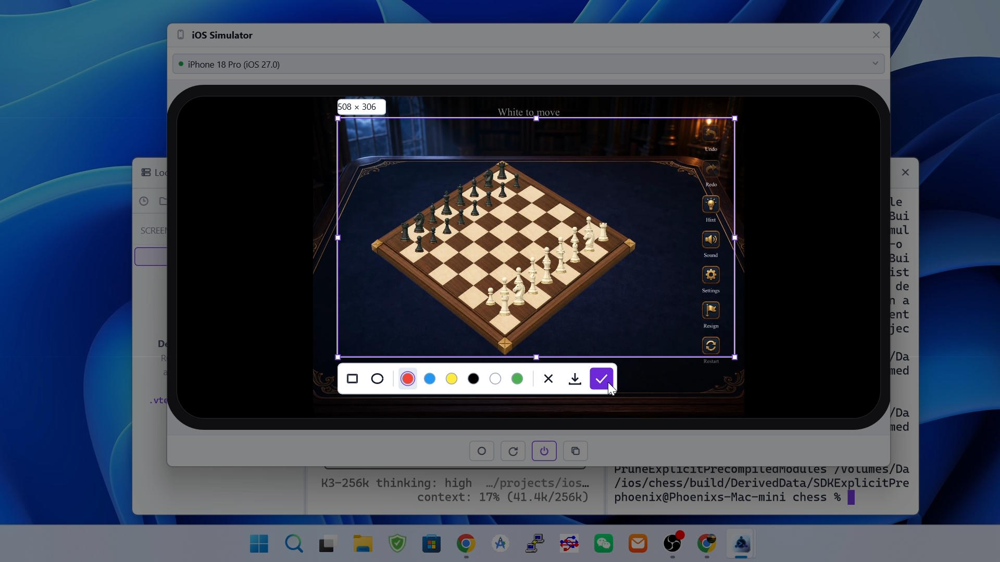
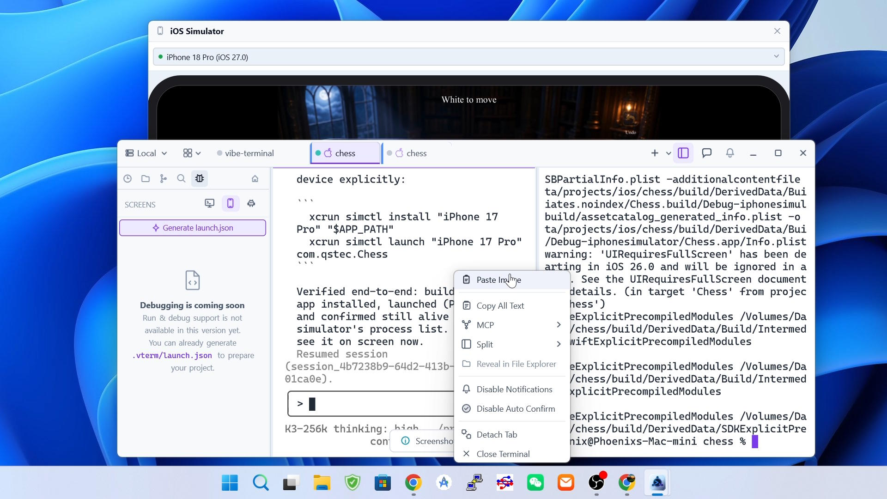

Screenshots and the terminal meet in one flow: press a single global hotkey to grab any region of the desktop, mark it up, and copy or save it — then paste the clipboard image straight into a terminal, where it lands as a file path the running program (a code agent included) can open and use. Both halves live in the desktop client.

## Taking a screenshot

- Press `Shift`+`Alt`+`A` anywhere: the hotkey is global, so it fires no matter which app has focus while the desktop client is running (on macOS, press `Shift`+`Command`+`A`);
- Every display dims under a capture overlay. Drag to draw the selection — it may span several displays — then drag inside it to move, or pull one of its handles to resize; a badge above the selection shows its size in pixels;
- Press `Esc` at any point to cancel.

## Annotating

The toolbar that appears under the selection carries the annotation tools on the left (rectangle and ellipse), six colors in the middle, and three action buttons on the right — cancel (`✕`), save (download arrow) and copy (`✓`).

- Pick a tool and a color, then drag inside the selection to draw; strokes are clipped to the selection;
- `Ctrl`+`Z` undoes the last annotation, `Ctrl`+`R` redoes it;
- Dragging a fresh area outside the current selection discards it — annotations included — and starts a new one.

## Copy or save

- `Copy` (`✓`) puts the annotated capture on the clipboard — ready to paste into a terminal (below), a chat, or any other app;
- `Save` (download arrow) writes a PNG through a save dialog; the file name defaults to `vterm-screenshot-<timestamp>.png`.

## Pasting an image into a terminal

- Copy an image to the clipboard — from the screenshot tool above, a browser, or the operating system's own capture;
- Right-click the terminal and pick `Paste Image`; the entry only appears when the clipboard actually holds an image;
- The image is uploaded to the session's server and stored there as a temporary file; its quoted path is then inserted at the terminal's cursor exactly as if typed — wrapped in bracketed-paste markers when the running app supports them, so shells, editors and agents receive it cleanly;
- To the program it is plain text: a code agent such as Claude Code or opencode opens the image from the path, and ordinary shell commands can use it as an argument.

## Notes

- The inserted path lives on the session's server: for a remote or WSL server the temporary file is created on that machine, right where the programs running in the terminal can reach it;
- Combined with `Adding Context to Agents`, this is the quickest way to show an agent something on your screen — capture, paste, and the agent holds the picture as a file;
- On Linux the capture works under X11; native Wayland sessions support neither the global hotkey nor the interactive overlay, and if another X11 app already grabbed `Shift`+`Alt`+`A`, the hotkey cannot register.
