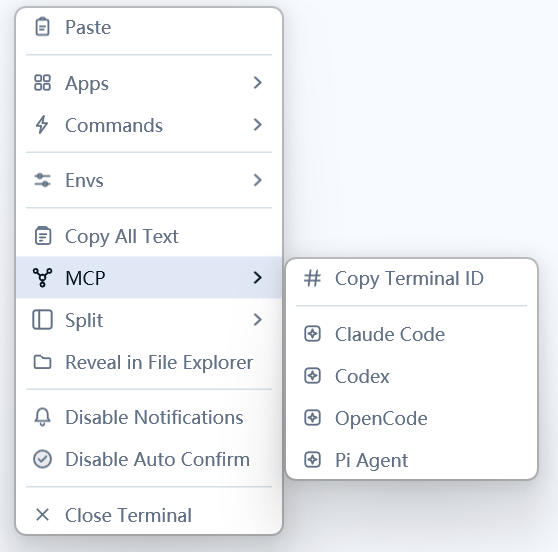

Every terminal is a first-class citizen of MCP (Model Context Protocol): external agents drive terminals through the server's MCP tools — list terminals, read the screen, run commands, wait for completion — letting the coding agent you already use operate real interactive shells.

## The server's terminal MCP tools

Around terminal sessions, an MCP client can:

- `list_terminals` — all open terminals; `get_terminal` — one terminal's title, cwd, and app status;
- `get_screen` — the current visible screen text; `get_scrollback` — recent history lines;
- `send_command` — run a command line (Enter appended); `send_input` — raw text without Enter (confirming `y`, filling forms); `send_key` — named keys (Enter, Ctrl+C, arrows);
- `clear_terminal` — blank the buffer; `resize_terminal` — resize the PTY; `wait_terminal` — block until the terminal is no longer busy.

## Addressing a terminal: the Terminal ID

Tool calls target a terminal by its Terminal ID. Right-click inside a terminal → `MCP` → `Copy Terminal ID`, then paste the ID to your agent so it drives exactly that terminal.

## One-click agent app onboarding

The `MCP` submenu also lists the agent apps detected on the server (editor CLIs and the like). Clicking an app types a ready-made `mcp add` command into the terminal — **without a trailing newline**; review it and press Enter yourself to register this server's MCP service with that agent. Entries hide while an app is already running in the session, so text can't land inside the app's UI.

> Typical loop: copy the Terminal ID to your agent → `send_command` starts a build → `wait_terminal` until done → `get_screen` reads the result. Together with Auto Confirm (see the terminal chapter), long interactive tasks run nearly unattended.
