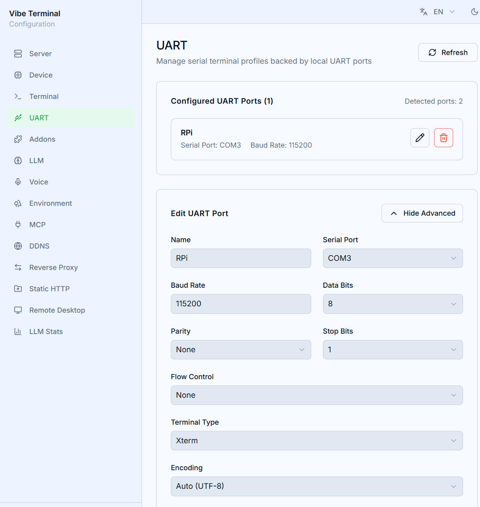

UART serial turns a device's serial console (debug port, embedded board, SBC) into a terminal tab you can watch and interact with like any other terminal.

## Configuring a port

In the Web UI's `UART` section → `Add UART Port`:

- `Name` — shown as the terminal's title (e.g. "Debug Console");
- `Serial Port` — pick from the detected ports (the count is shown at the top of the page);
- `Baud Rate` / `Data Bits` / `Parity` / `Stop Bits` / `Flow Control` — match the device firmware;
- `Terminal Type` and `Encoding` — encoding defaults to Auto (UTF-8) and can follow the firmware;
- `Show Advanced Options` exposes further serial parameters.

Saved ports appear in the `Configured UART Ports` list and can be edited or removed at any time.

## Using it in the client

Configured ports open as terminal tabs like ordinary server sessions:

- Serial data is displayed as it arrives; keyboard input goes straight to the port;
- The right-click menu offers `Clear` (blank the screen) and an `Encoding` submenu (switch encoding live; the current one is check-marked);
- UART sessions have no shell features (no Quick Commands, Apps, or Envs menu items).

Typical uses: router/switch consoles, embedded board logs, flash-jig monitoring.
