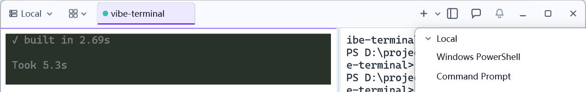
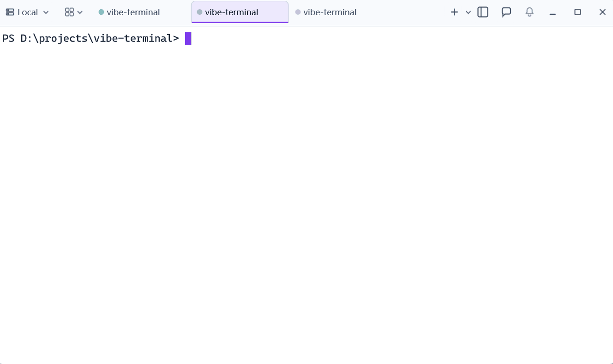
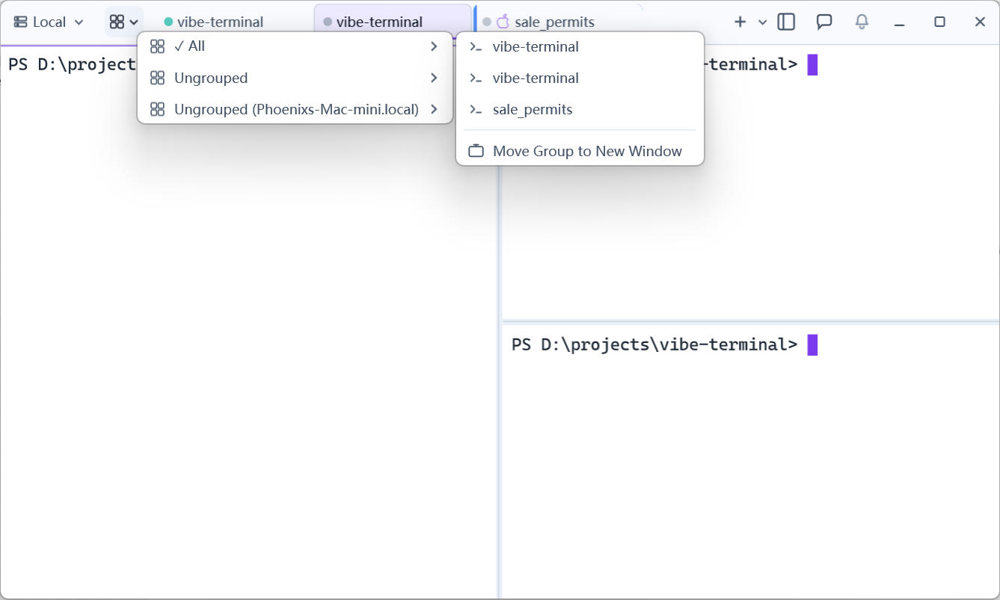

Terminals are the core of Vibe Terminal: each tab hosts one or more terminal sessions, can be split into panes, or dragged out into its own window. Terminals reach the local server as well as remote and shared servers through a relay.

## Creating terminals

- Click the `+` button in the title bar to open a tab with the default profile;
- Click the chevron next to `+` for the profile menu: terminal profiles grouped per server (local, connected, shared servers) — expand a group and pick a profile to open a terminal on that server;
- Drag a local folder onto the title bar and drop it to open a new tab with that working directory (local server only; the dropped item must be a folder).

## Mouse capture and the context menu

- Right-click inside a terminal opens its context menu: paste, split panes, quick commands, environment collections, copy-all-text, MCP setup lines and more, depending on the session;
- Applications that capture the mouse (opencode, pi, vim, tmux, htop, …) receive the pointer events instead — hold `Shift` to keep the regular operations available while such an app runs:
  - **Copy text**: hold `Shift` and select the text, then click somewhere else with `Shift` still held to deselect; the selection is copied to the clipboard;
  - **Context menu**: `Shift` + right-click or `Ctrl` + right-click opens the context menu; a right-click while the left button is held opens it too (any selection is cleared first);
  - **Links**: `Shift` + click follows links normally.
- To use regular terminal mouse behavior instead, choose `Disable Mouse` in the context menu or press `Ctrl+Shift+M` while the terminal is focused. This client-side per-terminal switch stops mouse reports to the app while preserving selection, links, scrolling and the context menu. Choose `Enable Mouse` or press the shortcut again to restore reporting.

## Splits and drag organization

- **Split**: right-click inside a terminal → `Split` → `Left` / `Right` / `Top` / `Bottom` divides the tab into panes, each an independent terminal;

  

- **Merge by drag**: drag a tab onto another terminal and dock zones appear (left/right/top/bottom); drop to merge the tab into the target tab as a new pane;

  

- **Detach to a window**: drag a tab out of the tab strip (or onto another window) and the whole tab leaves its window as a new one. Sessions always run on the server — splits, merges, and drags never interrupt a running command.

## Tabs and tab groups

- **Tab** — one terminal tab, possibly with several split panes;
- **Tab group** — a container organizing tabs. By default groups follow servers: the local server's tabs live in `Ungrouped`, and each shared server gets a `Name (Server)` group; custom groups are supported;
- **Groups and windows** — each window shows one active group through the title-bar group selector (or `All`); `Move Group to New Window` tears a whole group off into its own window, dedicating a window or monitor to one machine;
- **Groups and servers** — a group remembers its server, so switching groups refocuses a server's workspace; the profile menu follows the active group and only shows relevant servers' profiles.

