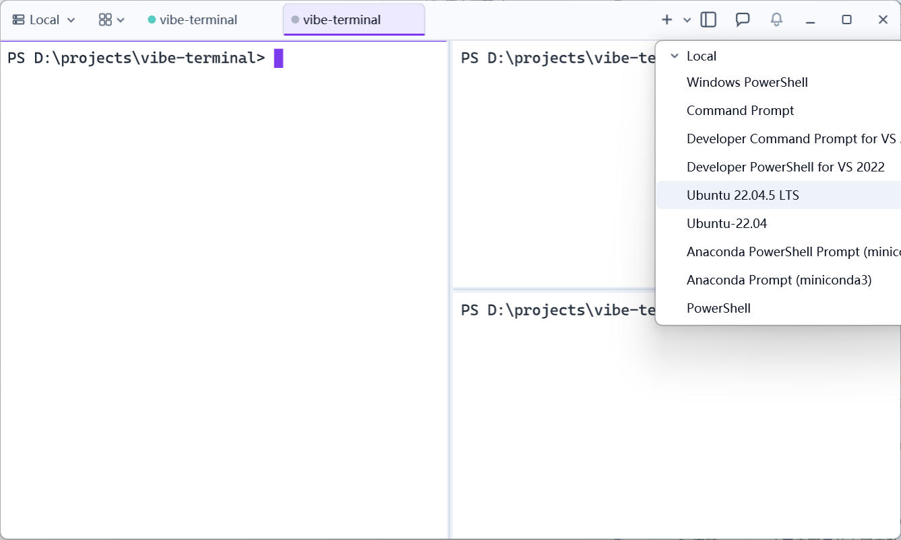

There are two ways to use WSL on Windows: the light way adds a WSL shell as a terminal profile, the full way installs vterm-server inside WSL. The former only gives you a shell; the latter unlocks file management, the Git panel, MCP, and everything else.

## The light way: a WSL terminal profile

On Windows, **WSL terminal profiles load automatically**: at startup the server detects `wsl.exe` and enumerates the installed distributions, adding one profile entry per distro to the profile list (e.g. `Ubuntu (WSL)`; a generic `WSL` entry appears when no distros are listed).

To use one, simply pick the WSL entry in the client's title-bar profile menu — the distro launches and drops you straight into its terminal, just like opening a local one.

Limitation: such sessions run on the Windows-side server — the client's **file explorer, Git panel, environment variables, and friends do not work** (they operate with Windows file-system semantics and cannot see the Linux file system inside WSL).



## The full way: install vterm-server inside WSL

Treat WSL as its own Linux machine and install the headless vterm-server. The website offers a one-line script — paste it into a WSL terminal:

```bash
curl -fsSL https://vterminal.dev/install.sh | bash
```

The script automatically:

1. Detects the WSL/headless environment and downloads the **headless** vterm-server into `~/.local/vterm`;
2. Installs a **systemd user service** and starts it immediately — it runs on every login (WSL start included), no manual start needed;
3. Adds `~/.local/vterm` to your PATH.

> When WSL has systemd disabled, the script points you at adding `[boot]` `systemd=true` to `/etc/wsl.conf`, running `wsl --shutdown` on the Windows side, and re-running the installer.

## Opening the configuration page

Inside WSL:

```bash
vterm-server --open
```

The command prints the Web UI address (`http://localhost:<config-port>/`) and tries to launch a browser (under WSL via `wslview`, the Windows default browser). Thanks to WSL2's localhost forwarding, **opening the same address in a Windows browser** works just as well. While the server is running, the printed URL carries a one-time sign-in token (`?ticket=...`, minted by the server over a local socket) so the page opens already signed in.

## (Optional) Share the WSL server into the host relay

If the Windows machine also runs vterm-server (acting as the relay), the WSL server can attach under it so the client sees both "machines" through one local connection:

1. On the Windows server's Web UI, click the QR code to copy the share string;
2. Open the WSL server's Web UI (address from the previous section), click the paste button that appears next to the `Relay Address` field to auto-fill address and key, then `Apply`;
3. While the Windows vterm-server runs, the client sees the WSL server's terminals, files, and Git under the local relay.

> Under WSL2's default NAT networking, WSL reaches the Windows host via the host's address on the WSL side (the default gateway — the nameserver in `cat /etc/resolv.conf`); with mirrored networking `localhost` works. See the Relay chapter for relay details.
