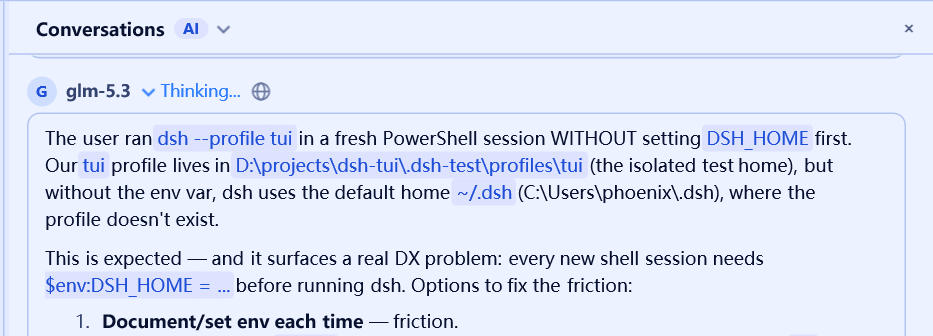
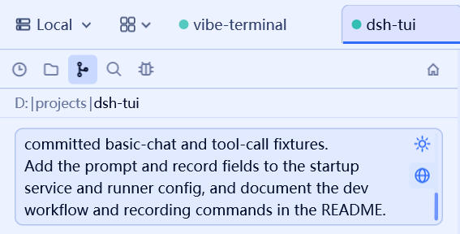
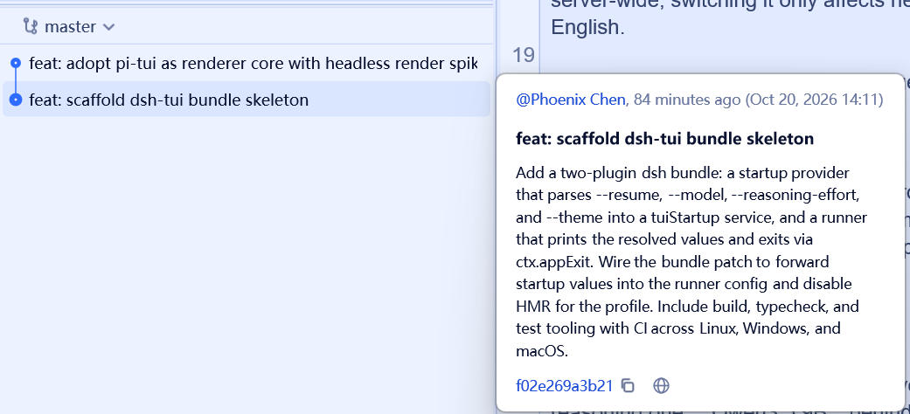
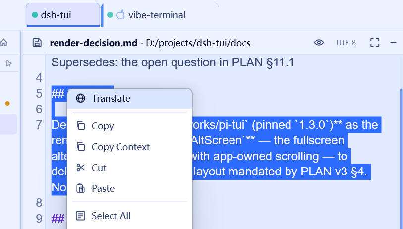
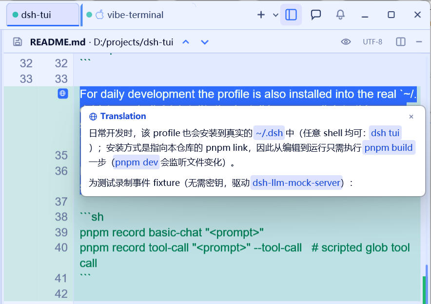

Once the server is configured, every client surface offers translation through the same globe icon. Results are cached per item, so switching back and forth never repeats a request.

## Chat panel messages

Every message header carries a translate icon — next to the time on your own messages, right of the sender name and time on model replies, and right of the `Thinking…` label on reasoning blocks:

- **First click** sends the message's raw Markdown to the server and swaps the message body for its translation. The icon lights up while the translation is shown;
- **Another click** restores the original text;
- The translation sticks to the message while the conversation stays open, including `Thinking…` blocks once you expand them.

Markdown renders normally in translated messages, so lists, tables and code blocks keep their shape.

## Commit message draft

In the Git panel's commit message box, a translate button appears beside the AI button once your draft spans more than one line:

- **Click** to translate the whole draft — the translated text replaces the draft in the box as a read-only preview;
- **Click again** to return to your original wording (the draft itself was never modified);
- Typing is disabled while the preview is shown; flip back first, then keep editing.

## Commit details popup

Hover a commit in the Git history to open the details popup. Next to the hash copy button sits a translate icon: click it to translate the commit message inside the popup; click again to see the original. The translated message is rendered like the original — subject line, Markdown body, code blocks included.

## Code editor selections

Select text in the code editor — regular or block (rectangular) selections both work — right-click and pick `Translate` (the first menu entry):

1. A solid globe badge appears over the line number of the first selected line;
2. A translation card opens immediately with a *Translating…* placeholder and fills in when the server replies;
3. The card is sticky: it stays put while you scroll, and only its close button, `Esc`, or a click outside dismisses it. Hovering the badge brings it back.

Each translated selection gets its own badge, and translating the same lines again simply re-shows the cached card. Badges disappear when you open another file.

## Diff view selections

The diff view works the same way: select lines in the diff body, right-click, `Translate`. The badge replaces the new line number on the first selected row, and the result card anchors below it. Selections in edit mode translate too; switching to another file or commit clears the badges.

## What gets translated

The server tells the model where the text came from:

- **Prose** (chat messages, commit messages) — Markdown formatting is preserved and only the natural language is translated;
- **File selections** (editor, diff) — the file name travels with the request, so the model knows the file's comment markers (`//`, `#`, `--`, …). Comment markers are stripped and the comment text is translated as prose; Markdown inside the comment (headings, lists, code fences) survives. If the selection is ordinary code, only comments and string literals are translated — identifiers and structure stay untouched.
