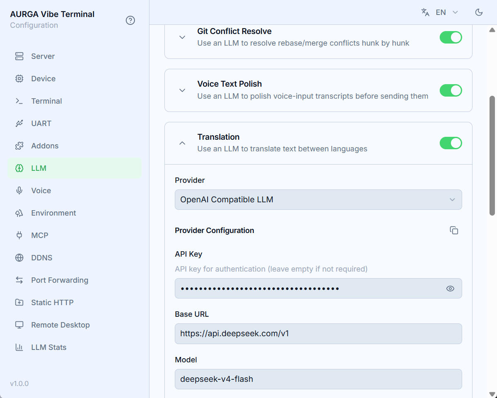
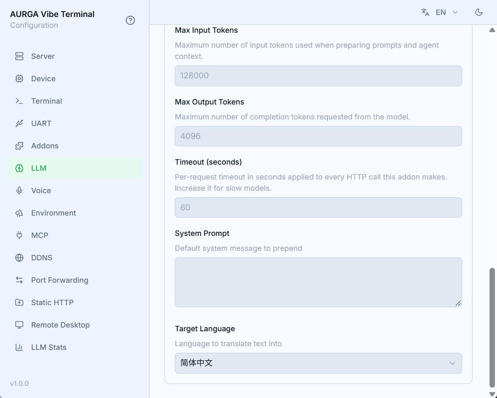

Translation is a per-feature LLM job configured once on the server. Every translation request from any client — chat messages, commit drafts, editor and diff selections — goes through the same settings.

## Enable the feature

Open the Web UI's `LLM` section and find the `Translation` card:

1. Toggle `Enable LLM translation` on;
2. Pick a `Provider` — the dropdown lists LLM addons that are **enabled** in the `Addons` section (the built-in **OpenAI Compatible LLM** provider covers most cases);
3. Fill in the provider's fields under `Provider Configuration` (for the built-in provider: `Base URL`, `API Key`, `Model`, and optionally `Extra Body`, token limits, `Timeout`);
4. Choose the `Target Language` every translation is written in.

Configuration is saved even while the feature is disabled, but the server only applies it once the toggle is on. Without it, client requests fail with *"translation addon is not configured or disabled"*.

## Target language

Unlike the terminal and Git features, translation has no `Auto` option — it always translates into one explicit language from the list (English, 简体中文, 繁體中文, Deutsch, Español, Français, 日本語, 한국어, Nederlands, Polski, Português, Русский, ไทย, Tiếng Việt, العربية, Bahasa Indonesia, Bahasa Melayu, Українська). The setting applies server-wide; switching it only affects new requests. An unset language falls back to English.

## Reusing a provider's credentials

The copy/paste buttons next to the `Provider Configuration` heading clone field values between feature cards that use the same provider addon — pick and fill the provider once (say, for Git commit messages), press **Copy**, then **Paste** it into the Translation card.

## Choosing a model

Translations are short, latency-sensitive prompts — a fast model beats a large reasoning one. **Qwen3.5 9B** behind an OpenAI-compatible endpoint (Ollama, vLLM, llama.cpp) or **DeepSeek V4 Flash** via API both work well. The server allows up to 60 seconds per request; slow local models may need a higher `Timeout` in the provider fields.

> Thinking mode adds seconds of latency for no quality gain here — disable it in `Extra Body`, e.g. `{"enable_thinking": false}` for Qwen or `{"thinking": {"type": "disabled"}}` for DeepSeek.
