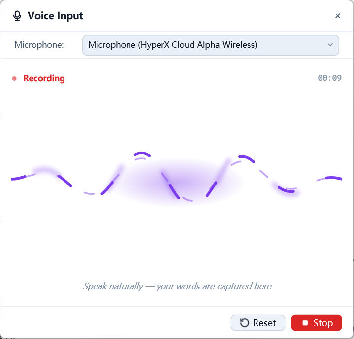
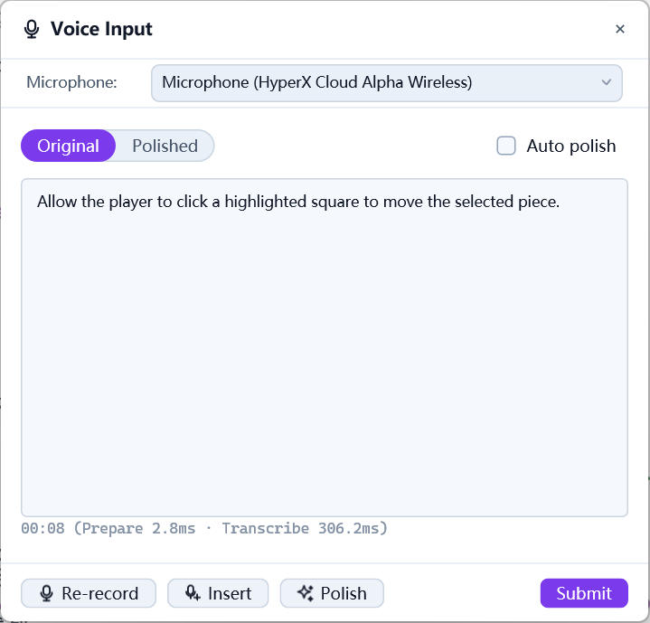

Press `Ctrl` twice in quick succession (within ~300 ms) anywhere in the desktop client to open the voice input dialog.

## Recording

The dialog starts recording immediately: the liquid waveform follows your voice, the top selector switches microphones (the choice is remembered), and a timer shows the elapsed time. `Stop` ends the clip and sends it for transcription (`Reset` restarts).

## Processing

A particle-stream animation plays while the server transcribes the audio.

## Editing

The transcript lands in an editable text box:

- The mode pill toggles between `original` and `polished`; `Polish` runs the LLM once, and `Auto polish` does it right after every transcription;
- `Re-record` discards the text and starts over; `Insert` records again and splices the new transcript into the existing text at the caret (replacing any selection), so you can extend or amend what you already dictated — the caret lands right after the inserted snippet;
- Hover the text box to reveal a copy button at its top-right corner: click to copy the text and it flips to a checkmark; editing the text or switching modes re-arms it for another copy;
- `Submit` (or `Ctrl+Enter`) types the text into the active terminal; `Esc` closes the dialog.

## Polishing setup

`Polish` needs a voice-polish LLM: in the Web UI's `LLM` section, enable `Enable voice text polish` in the per-feature list (a regular provider plus this toggle is all it takes). Without it the `Polish` button stays greyed out and the auto-polish option is hidden.
