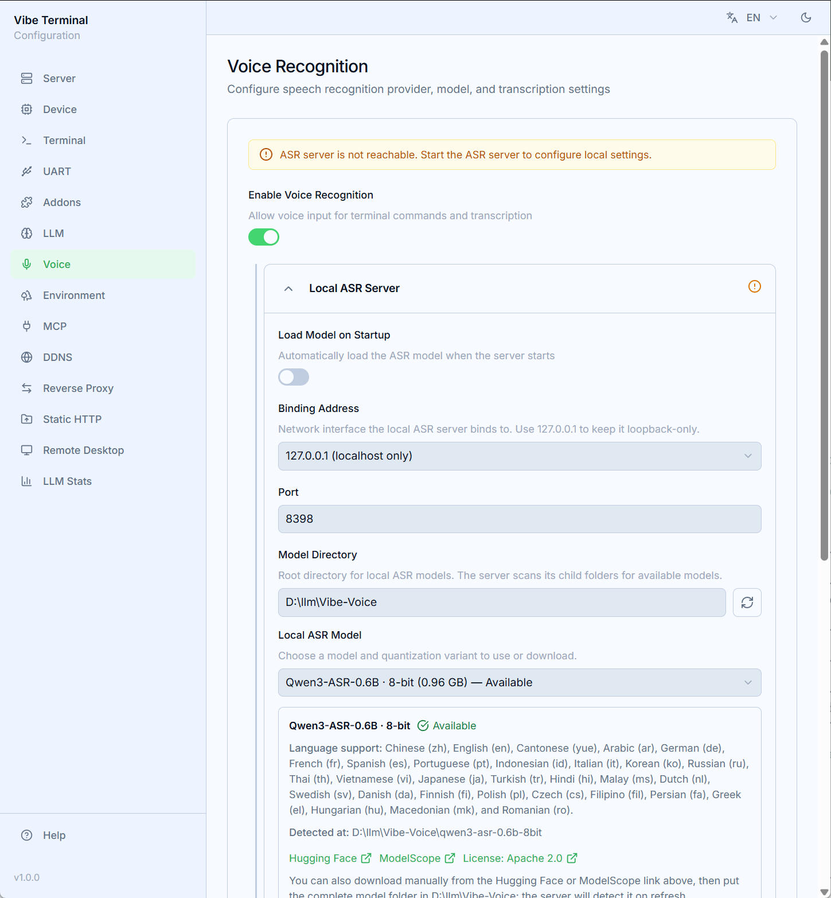
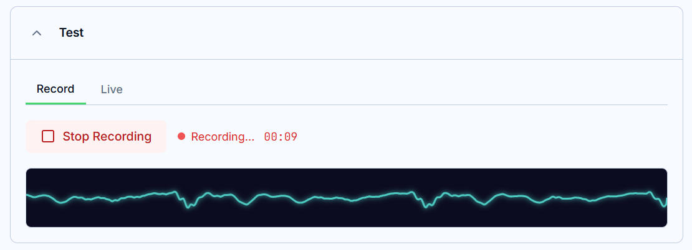

Voice input turns speech into terminal input: talk instead of typing, with optional LLM polish for the transcript before it is sent. Recognition runs as a local ASR server with on-device models — audio and text stay on your machine. This page covers the server side; the desktop experience lives in Using the Client.

## The Local ASR Server card

Open the `Voice` section of the Web UI and enable voice recognition. The `Local ASR Server` card manages the supervised vterm-voice process:

- `Load on Startup` — start the ASR server together with the backend;
- `Bind Address` (`127.0.0.1` localhost-only / `0.0.0.0` all interfaces) and `Port` (default `8398`) — where the ASR endpoint listens;
- `Model Directory` + `Local Model` — pick from the built-in catalog: Qwen3-ASR, Fun-ASR and Parakeet families, each in full / 8-bit / 4-bit variants. `Download` fetches the model from Hugging Face or ModelScope into the directory with a live progress bar; manual `git clone` commands are shown as a fallback, and models already on disk are marked available;
- `Device` — the inference backend (`Auto`, `CPU`, `CUDA`, `Vulkan`, `Metal`), as reported by the server;
- `Access Token` — shared secret for the endpoint; the dice button generates one;
- `Save` persists the card (edits stay a local draft until then), and `Start Server` / `Stop Server` control the process. The status icon in the card title reflects reachability and model state (loaded / loading / error).

> **CUDA contention**: when another CUDA inference program already occupies the GPU (e.g. llama.cpp running a local model), letting vterm-voice use `CUDA` as well can slow both down drastically. In that case set `Device` to `CPU` — these compact ASR models are fast enough on CPU.

## Provider and testing

The provider dropdown lists ASR addons — the built-in `vibe-voice` addon points at this supervised server, so selecting it is how the panel uses your local models.

The `Test` area tries everything without a client: `Record` (microphone → waveform → transcription) and `Live` (streaming recognition), each with timings and a copy button.

